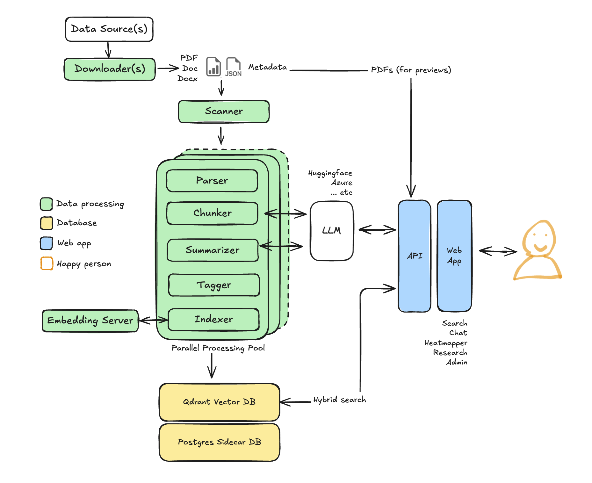

# Evidence Lab



Evidence Lab is a free, open source platform for searching and analyzing collections of reports. It parses PDF and Word documents, indexes them for hybrid semantic search, and adds an AI research assistant, briefs and maps. MCP and A2A servers connect it to AI platforms.

This image runs the API, the MCP server and the document pipeline. One image runs all three, each with a different start command. The web interface is built on your machine from the repository, because it carries your API key or sign-in setting, data sources and branding.

- **Source and issues:** https://github.com/dividor/evidencelab
- **Setup guide:** https://github.com/dividor/evidencelab/blob/main/docs/admin/docker-images.md
- **Demo:** https://evidencelab.ai
- **Mirror without Docker Hub pull limits:** `ghcr.io/dividor/evidencelab`

## Tags

| Tag | Meaning |
|---|---|
| `X.Y.Z` | An exact release. Use this in production. |
| `X.Y` | The newest patch of a minor release. |
| `latest` | The newest release. |
| `rc-vX.Y.Z` | The release candidate in progress, for testing only. It changes as work is merged. |

Every tag covers `linux/amd64` and `linux/arm64`.

## Quick start

You need [Docker](https://docs.docker.com/get-started/get-docker/) with Compose, [Python 3](https://www.python.org/downloads/) and git, plus an API key for one model provider (Azure Foundry, Hugging Face or Google Vertex).

```bash
git clone https://github.com/dividor/evidencelab.git
cd evidencelab
python3 scripts/demo/run_demo.py --mode hub
```

The script asks for your provider and its key, generates every password and secret, loads three World Bank reports as demo data, and starts Evidence Lab. Then open http://localhost:8080. It runs the newest release, `latest`; add `--version` with a tag to pin a specific release. The setup guide covers manual setup, your own documents and upgrades.

Each image carries build provenance and a software bill of materials:

```bash
docker buildx imagetools inspect astrobagel/evidencelab:<version> --format '{{ json .SBOM }}'
```

Evidence Lab is released under the MIT License.
