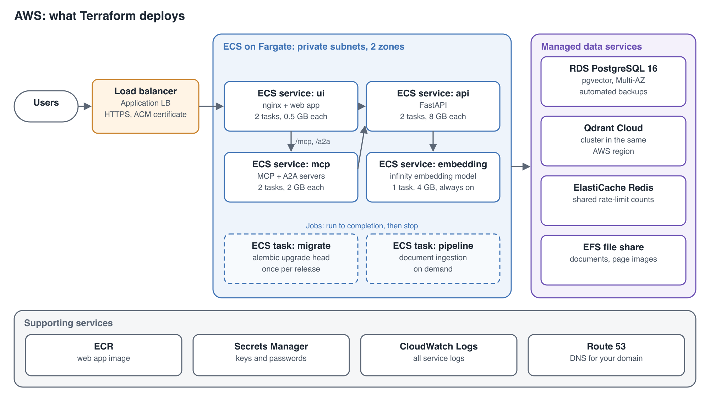

# Example Deployment: AWS

This example runs Evidence Lab on Amazon ECS with Fargate, with Amazon RDS for Postgres, Qdrant Cloud, ElastiCache, EFS and an Application Load Balancer. It follows the layout in [Deploying to the Cloud](cloud-deployment.md).

> **Status:** this example is being built. This page describes exactly what it deploys. The Terraform template, the tested commands and the measured running cost are added here once the example has been deployed and tested end to end.

## What the example deploys

| Part | AWS service | Example size |
|---|---|---|
| Network | A VPC (`10.0.0.0/16`) across two availability zones. Public subnets hold the load balancer and a NAT gateway; private subnets hold everything else. | One NAT gateway, so the containers can pull images and reach the model providers and Qdrant Cloud |
| Load balancer | Application Load Balancer, HTTPS on port 443 with an ACM certificate, HTTP redirected to HTTPS | Idle timeout 300 seconds, for streaming chat and MCP connections |
| ui | ECS service on Fargate, your web app image from ECR | 2 tasks, 0.25 vCPU, 0.5 GB each |
| api | ECS service on Fargate, `astrobagel/evidencelab` | 2 tasks, 2 vCPU, 8 GB each |
| mcp | ECS service on Fargate, `astrobagel/evidencelab` | 2 tasks, 0.5 vCPU, 2 GB each |
| embedding | ECS service on Fargate, `michaelf34/infinity:0.0.70` | 1 task, 1 vCPU, 4 GB, always running |
| migrate | ECS task on Fargate, run before each release | 0.5 vCPU, 1 GB |
| pipeline | ECS task on Fargate, run when you ingest documents | 4 vCPU, 16 GB |
| Postgres | Amazon RDS for PostgreSQL 16, Multi-AZ, with the `vector` extension | db.t4g.medium, 50 GB gp3 storage, 7 days of automated backups |
| Qdrant | Qdrant Cloud cluster in the same AWS region | Sized from your collection |
| Redis | Amazon ElastiCache (Valkey, compatible with Redis), encrypted in transit | cache.t4g.micro |
| Documents and page images | Amazon EFS, mounted at `/app/data` in the api and pipeline | Elastic throughput |
| Web app image | Amazon ECR repository | — |
| Keys and passwords | AWS Secrets Manager | — |
| Logs | Amazon CloudWatch Logs, one log group per service | 30 days |
| Domain | An Amazon Route 53 record pointing at the load balancer | — |

All resources are tagged with the deployment name, so you can find them later.

## How the services find each other

The api, mcp and embedding services register in an AWS Cloud Map private DNS namespace, `evidencelab.internal`. These are the values the example sets, using the settings described in [Deploying to the Cloud](cloud-deployment.md#settings):

| Container | Setting | Value |
|---|---|---|
| ui | `API_UPSTREAM` | `http://api.evidencelab.internal:8000` |
| ui | `MCP_UPSTREAM` | `http://mcp.evidencelab.internal:8001` |
| ui | `NGINX_RESOLVER` | `10.0.0.2`, the VPC's DNS server |
| ui | `NGINX_REAL_IP_FROM` | `10.0.0.0/16` |
| api | `FORWARDED_ALLOW_IPS` | `10.0.0.0/16` |
| api, mcp | `RATELIMIT_STORAGE_URL` | `rediss://<ElastiCache endpoint>:6379/0` |
| api, mcp, pipeline, migrate | `POSTGRES_HOST` | The RDS endpoint |
| api, mcp, pipeline, migrate | `PGSSLMODE`, `PGSSLROOTCERT` | `verify-full`, and the RDS certificate bundle |
| api, mcp, pipeline | `QDRANT_HOST`, `QDRANT_API_KEY` | Your Qdrant Cloud cluster's URL and key |
| api, pipeline | `EMBEDDING_API_URL` | `http://embedding.evidencelab.internal:7997` |

The api starts with `uvicorn ui.backend.main:app --host 0.0.0.0 --port 8000 --workers 1`, without the migration step. The migrate task runs `alembic upgrade head` first.

## Deploying the example

**You need:**
- an AWS account, and the AWS CLI signed in to it;
- Terraform and Docker on your machine;
- a domain you can point at the load balancer;
- a Qdrant Cloud cluster in your AWS region, with its URL and API key;
- your model provider keys, and your `config.json`.

**The steps:**
1. Copy the example settings file and fill in the region, domain, sizes, Evidence Lab version and the names of your keys.
2. Run Terraform to create the network, databases, file share, registry, load balancer and services.
3. Build the web app image with your settings and push it to ECR.
4. Run the migrate task and wait for it to finish.
5. The services start and pass their health checks. Open your domain.
6. Run the pipeline task to ingest your documents.

**Upgrading:** set the new Evidence Lab version, rebuild the web app image, run the migrate task, then let ECS replace the tasks one at a time.

**Removing the example:** `terraform destroy` removes everything it created. The Qdrant Cloud cluster is removed in Qdrant's console.

## What the test deployment checks

The example is tested by deploying it into a test account and checking that:
- the site answers over HTTPS;
- search, chat, briefs, sign-in and ratings work, and documents and page images open;
- chat streams for over a minute without being cut off, and an MCP client connects;
- the databases can't be reached from the internet;
- losing an api task and failing over the database don't lose data or requests;
- an upgrade causes no downtime;
- a database backup restores;
- tear-down leaves nothing behind.

Running costs are measured during this test and added here.
