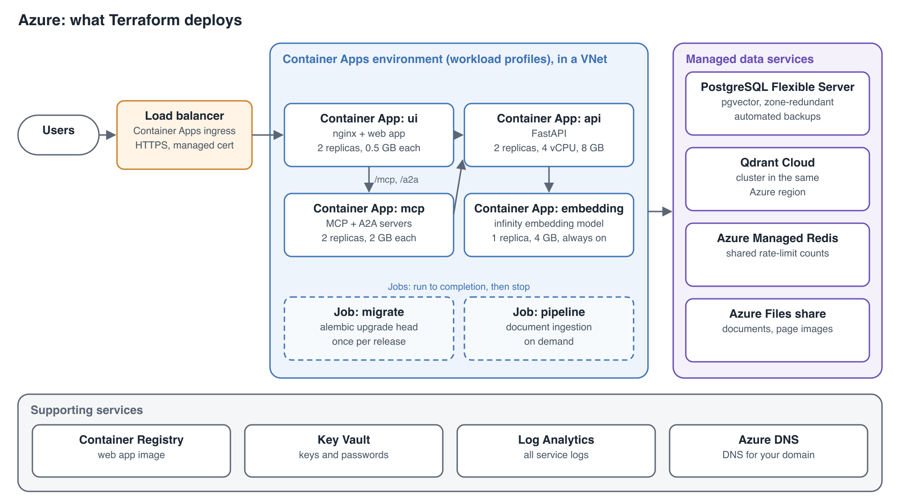

# Example Deployment: Azure

This example runs Evidence Lab on Azure Container Apps, with Azure Database for PostgreSQL, Qdrant Cloud, Azure Managed Redis and Azure Files. It follows the layout in [Deploying to the Cloud](cloud-deployment.md).

> **Status:** this example is being built. This page describes exactly what it deploys. The Terraform template, the tested commands and the measured running cost are added here once the example has been deployed and tested end to end.

## What the example deploys

| Part | Azure service | Example size |
|---|---|---|
| Network | A resource group and a virtual network, with subnets for the Container Apps environment, Postgres and private endpoints | — |
| Load balancer | The Container Apps environment's ingress, HTTPS with a free managed certificate for your domain | Only the ui app is reachable from the internet |
| Container platform | A Container Apps environment of the workload-profiles type, using the Consumption profile | Needed for the 4 vCPU, 8 GB size the api uses |
| ui | Container app, your web app image from Azure Container Registry | 2 replicas, 0.25 vCPU, 0.5 GB each |
| api | Container app, `astrobagel/evidencelab` | 2 replicas, 4 vCPU, 8 GB each (the Consumption profile's largest size) |
| mcp | Container app, `astrobagel/evidencelab` | 2 replicas, 1 vCPU, 2 GB each |
| embedding | Container app, `michaelf34/infinity:0.0.70` | 1 replica, 2 vCPU, 4 GB, never scaled to zero |
| migrate | Container Apps job, run before each release | 0.5 vCPU, 1 GB |
| pipeline | Container Apps job, run when you ingest documents | 4 vCPU, 8 GB |
| Postgres | Azure Database for PostgreSQL flexible server 16, zone-redundant high availability, with `vector` allowed in the `azure.extensions` server setting | General Purpose, 2 vCores, 128 GB storage, 7 days of backups |
| Qdrant | Qdrant Cloud cluster in the same Azure region | Sized from your collection |
| Redis | Azure Managed Redis | The smallest size |
| Documents and page images | An Azure Files share, mounted at `/app/data` in the api and pipeline | Sized from your data |
| Web app image | Azure Container Registry | — |
| Keys and passwords | Azure Key Vault | — |
| Logs | A Log Analytics workspace | 30 days |
| Domain | An Azure DNS record for your domain | — |

The example uses Azure Managed Redis because Microsoft no longer lets you create new Azure Cache for Redis instances.

The pipeline job runs the same way as the existing scripts in `scripts/pipeline/azure/container-apps/`. Processing large batches needs more than the Consumption profile's 8 GB; add a dedicated workload profile for that, or ingest elsewhere and copy the results in.

## How the services find each other

The api, mcp and embedding apps use internal ingress, so only apps inside the environment can reach them. These are the values the example sets, using the settings described in [Deploying to the Cloud](cloud-deployment.md#settings):

| Container | Setting | Value |
|---|---|---|
| ui | `API_UPSTREAM` | `http://api.internal.<environment domain>` |
| ui | `MCP_UPSTREAM` | `http://mcp.internal.<environment domain>` |
| ui | `NGINX_RESOLVER` | `168.63.129.16`, Azure's DNS server |
| ui | `NGINX_REAL_IP_FROM` | The Container Apps subnet's range |
| api | `FORWARDED_ALLOW_IPS` | The Container Apps subnet's range |
| api, mcp | `RATELIMIT_STORAGE_URL` | `rediss://<Azure Managed Redis host>:10000/0` |
| api, mcp, pipeline, migrate | `POSTGRES_HOST` | The flexible server's name |
| api, mcp, pipeline, migrate | `PGSSLMODE`, `PGSSLROOTCERT` | `verify-full`, and the certificate authorities Azure Database for PostgreSQL uses |
| api, mcp, pipeline | `QDRANT_HOST`, `QDRANT_API_KEY` | Your Qdrant Cloud cluster's URL and key |
| api, pipeline | `EMBEDDING_API_URL` | `http://embedding.internal.<environment domain>` |

The api starts with `uvicorn ui.backend.main:app --host 0.0.0.0 --port 8000 --workers 1`, without the migration step. The migrate job runs `alembic upgrade head` first.

## Deploying the example

**You need:**
- an Azure subscription, and the Azure CLI signed in to it;
- Terraform and Docker on your machine;
- a domain you can point at the environment;
- a Qdrant Cloud cluster in your Azure region, with its URL and API key;
- your model provider keys, and your `config.json`.

**The steps:**
1. Copy the example settings file and fill in the region, domain, sizes, Evidence Lab version and the names of your keys.
2. Run Terraform to create the network, databases, file share, registry, Key Vault and the Container Apps environment.
3. Build the web app image with your settings and push it to Azure Container Registry.
4. Start the migrate job and wait for it to succeed.
5. The apps start. Add your domain's DNS record, and the managed certificate is issued. Open your domain.
6. Start the pipeline job to ingest your documents.

**Upgrading:** set the new Evidence Lab version, rebuild the web app image, run the migrate job, then deploy new revisions of the apps.

**Removing the example:** `terraform destroy` removes the resource group and everything in it. The Qdrant Cloud cluster is removed in Qdrant's console.

## What the test deployment checks

The example is tested by deploying it into a test subscription and checking that:
- the site answers over HTTPS;
- search, chat, briefs, sign-in and ratings work, and documents and page images open;
- chat streams for over a minute without being cut off by the ingress timeout, and an MCP client connects;
- the databases can't be reached from the internet;
- restarting the api and failing over the database don't lose data or requests;
- an upgrade causes no downtime;
- a database backup restores;
- tear-down leaves nothing behind.

Running costs are measured during this test and added here.
