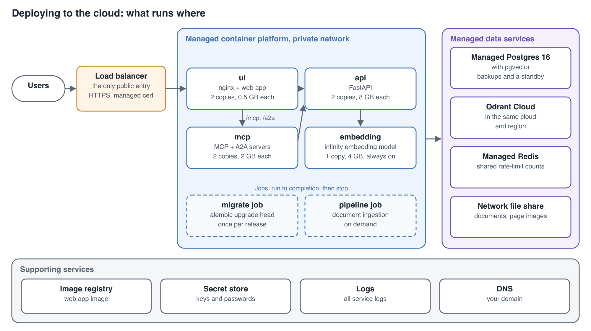
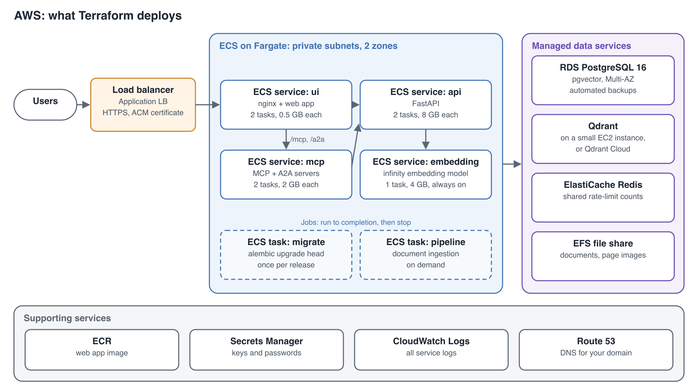
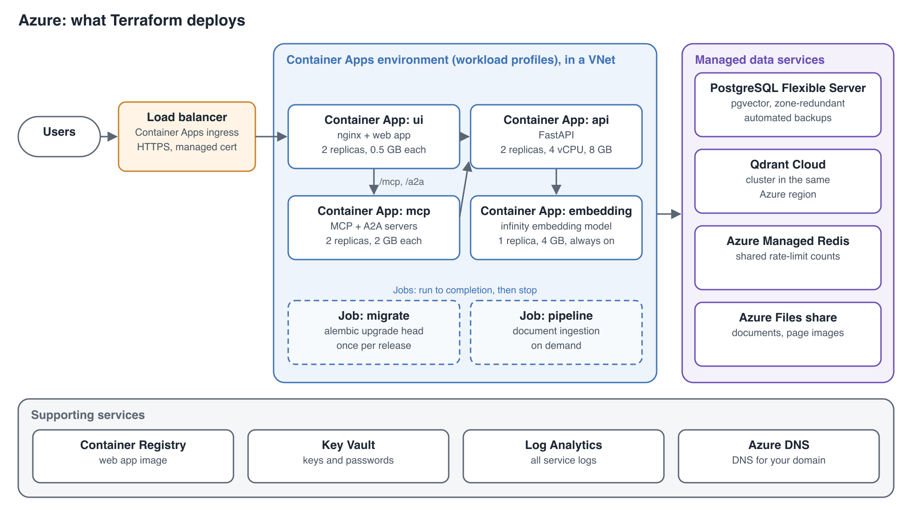
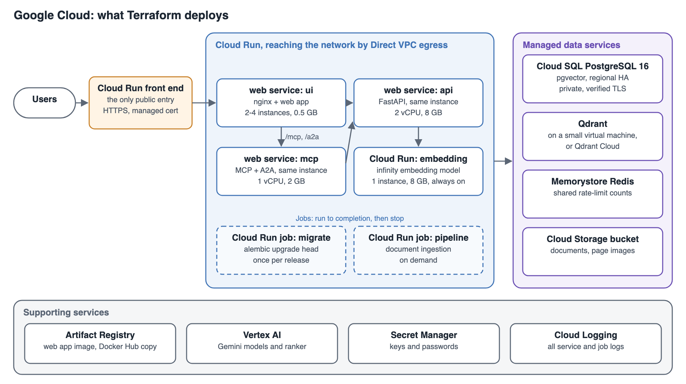

# Deploying to Cloud Platforms

Evidence Lab runs as a set of containers. On one machine, Docker Compose runs them all, databases included (see [Running from the Published Image](docker-images.md)). On a cloud's managed container service the same images run, with three differences:

- Each service can run several copies behind a load balancer.
- The databases and file storage are the cloud's managed services, not containers.
- A few settings tell the containers where everything is.

This page describes that layout and its settings, with an example deployment for AWS, Azure and Google Cloud.

**On this page**

| Section | What it covers |
|---|---|
| [The cloud layout](#the-cloud-layout) | What runs where, and why the databases are managed services |
| [Settings](#settings) | The settings a load-balanced deployment needs |
| [Example: AWS](#example-aws) | Amazon ECS on Fargate, with step-by-step deploy and teardown |
| [Example: Azure](#example-azure) | Azure Container Apps (template not built yet) |
| [Example: Google Cloud](#example-google-cloud) | Cloud Run (template not built yet) |
| [Not included](#not-included) | What this layout does not cover |

> **These are demonstration deployments, not a production design.** They show that Evidence Lab runs on each cloud's container service and how the parts fit together. Before running a production service, review the deployment for your organisation, including:
>
> - **Security:** Network access, sign-in settings, how keys and passwords are stored and rotated, and where the Terraform state is kept (it holds generated keys).
> - **Reliability:** Sizes and copies for your traffic, database backups and restores, and failover.
> - **Operations:** Monitoring and alerts, log retention, upgrades and running costs.
> - **Your obligations:** Data protection, data residency, and the terms of the documents you load.

## The cloud layout

Every example uses the same layout. Only the names of the cloud services change.



### What runs where

| Part | Runs as | Notes |
|---|---|---|
| Load balancer | The cloud's load balancer | The only public entry point. It ends HTTPS and sends all traffic to the ui service. |
| ui | Container service, 2 or more copies | The production web app image (`ui/frontend/Dockerfile.prod`). nginx serves the web app, forwards `/api` to the api, and forwards `/mcp` and `/a2a` to the mcp service. It is built for each deployment, because the build fixes the sign-in mode, data sources and branding into the page. |
| api | Container service, 2 or more copies | The published `astrobagel/evidencelab` image. |
| mcp | Container service, 2 or more copies | The same image, started with `python -m mcp_server.http_server`. |
| embedding | Container service, 1 copy, always running | The `michaelf34/infinity` image. It must keep running, because loading the model takes several minutes. |
| migrate | A job, run before each release starts | The same image, running `alembic upgrade head`. |
| pipeline | A job, run when you ingest documents | The same image, running the pipeline orchestrator. |
| Postgres 16 with pgvector | The cloud's managed Postgres | Backups, a standby copy and patching come with the service. |
| Qdrant | Qdrant Cloud, or Qdrant on a small virtual machine | See below. |
| Redis | The cloud's managed Redis | Holds the rate-limit counts that all api and mcp copies share. |
| Documents and page images | The cloud's network file share | Mounted at `/app/data`. The pipeline writes the files and the api serves them. |

The sizes in the figure come from the memory limits in `docker-compose.prod.yml`.

### Why the databases are managed services

Managed container services don't keep a long-running service's disk when it is redeployed or restarted. On Amazon ECS, a block-storage volume attached to a service's container is deleted when the container stops. Azure Container Apps and Google Cloud Run offer only network file shares and memory. Qdrant needs block storage and does not work on network file systems. So Postgres runs on the cloud's managed Postgres, and Qdrant runs on Qdrant Cloud or on its own virtual machine.

## Settings

Docker Compose needs none of these settings, because the defaults match it. A cloud deployment sets them on the containers listed.

### Where the ui finds the other services

The ui container writes these into its nginx configuration when it starts. If a value is not valid, the container stops with an error.

| Setting | Set on | Default | Set it to |
|---|---|---|---|
| `API_UPSTREAM` | ui | `http://api:8000` | The api service's address, for example `http://api.evidencelab.internal:8000` |
| `MCP_UPSTREAM` | ui | `http://mcp:8001` | The mcp service's address |
| `NGINX_RESOLVER` | ui | `127.0.0.11` (Docker's DNS server) | The cloud network's DNS server |
| `NGINX_REAL_IP_FROM` | ui | `127.0.0.1` (no proxy trusted) | The load balancer's address range, for example `10.0.0.0/16` |

nginx looks up the api and mcp addresses through `NGINX_RESOLVER` while it runs, so it follows a service when the platform replaces it at a new address.

### Visitors' real addresses

Rate limits count requests per visitor address. Behind a load balancer and nginx, every request reaches the api from nginx's address, so without these two settings all visitors share one count.

- **`NGINX_REAL_IP_FROM` on the ui.** nginx takes the visitor's address from the `X-Forwarded-For` header that the load balancer adds. Only proxies in this range are believed, so visitors cannot fake their address. The mcp server rate-limits on the address nginx passes on.
- **`FORWARDED_ALLOW_IPS` on the api.** List the addresses of the ui copies, for example `10.0.0.0/16`. The api then takes the visitor's address from the header nginx sends. Without it, the api trusts only its own machine (`127.0.0.1`).

### Rate limits shared by all copies

| Setting | Set on | Value |
|---|---|---|
| `RATELIMIT_STORAGE_URL` | api, mcp | `redis://<redis-host>:6379/0`, or `rediss://` for Redis over TLS |

Without it, each copy keeps its own counts, so with two copies a visitor gets twice the limit. The sign-in attempt limit (`AUTH_RATE_LIMIT_MAX`) is always counted by each copy separately.

### Postgres over verified TLS

| Setting | Set on | Value |
|---|---|---|
| `PGSSLMODE` | api, mcp, pipeline, migrate | `verify-full` |
| `PGSSLROOTCERT` | api, mcp, pipeline, migrate | The path, inside the container, to the cloud's certificate authority bundle |

Every Postgres connection Evidence Lab makes reads these standard settings. With `verify-full`, a connection is refused unless the server's certificate is signed by that authority and matches `POSTGRES_HOST`. Without them, connections are encrypted when the server supports TLS, but the certificate is not checked.

### Starting the api

Start the api copies without the migration step:

```bash
uvicorn ui.backend.main:app --host 0.0.0.0 --port 8000 --workers 1
```

Run `alembic upgrade head` once, as a job, before new api copies start. If every copy migrated at start-up, as the compose files do, they would run the same migration at the same time.

## Example: AWS

This example runs Evidence Lab on Amazon ECS with Fargate. The template and scripts are in [`deploy/aws`](../../deploy/aws/).



### What the AWS example deploys

The sizes are the template's defaults. The demo below uses smaller ones.

| Part | AWS service | Default size |
|---|---|---|
| Network | A VPC (`10.0.0.0/16`) across two availability zones. The load balancer and a NAT gateway are in public subnets. Everything else is in private subnets. | One NAT gateway, through which the containers pull images and reach the model providers |
| Load balancer | Application Load Balancer. With a domain, it serves HTTPS with an ACM certificate and redirects HTTP. Without one, it serves plain HTTP on its own address, for testing only. | Idle timeout of 300 seconds, for streaming chat and MCP |
| ui | ECS service on Fargate (arm64), running the web app image that the deploy script pushes to ECR | 2 tasks, 0.25 vCPU and 0.5 GB each |
| api | ECS service on Fargate (arm64), `astrobagel/evidencelab` | 2 tasks, 2 vCPU and 8 GB each |
| mcp | ECS service on Fargate (arm64), `astrobagel/evidencelab` | 2 tasks, 0.5 vCPU and 2 GB each |
| embedding | ECS service on Fargate (arm64), `michaelf34/infinity:0.0.70` | 1 task, 1 vCPU and 4 GB, always running |
| migrate | ECS task on Fargate, run by the deploy script before the services start | 0.5 vCPU, 1 GB |
| pipeline | ECS task on Fargate, run when you ingest documents | 4 vCPU, 16 GB |
| Postgres | Amazon RDS for PostgreSQL 16, Multi-AZ and encrypted. RDS keeps the password in Secrets Manager. | db.t4g.medium, 50 GB storage, 7 days of backups |
| Qdrant | Qdrant 1.18.3 on an EC2 instance in a private subnet, or your Qdrant Cloud cluster if you set `qdrant_url` | t4g.medium, 30 GB disk |
| Redis | Amazon ElastiCache (Valkey, compatible with Redis), encrypted in transit | cache.t4g.micro |
| Documents and page images | Amazon EFS, mounted at `/app/data` | Elastic throughput |
| Web app image | Amazon ECR repository `<name>/ui` | — |
| Keys and passwords | AWS Secrets Manager: `<name>/app` holds the generated keys, `<name>/providers` any model provider keys | — |
| Model access | An IAM task role for the api, mcp, pipeline and migrate containers, allowed to call Amazon Bedrock models | — |
| Logs | Amazon CloudWatch Logs, one log group per service, `/ecs/<name>/<service>` | 30 days |
| Domain | A Route 53 record pointing at the load balancer, if you set a domain | — |

`<name>` is the deployment name you choose. Every resource is tagged `Deployment=<name>`, so the AWS console's Tag Editor can list them all.

### How the AWS services find each other

The api, mcp and embedding services register their addresses in a private DNS namespace, `<name>.internal` (AWS Cloud Map). The template sets these values:

| Container | Setting | Value |
|---|---|---|
| ui | `API_UPSTREAM` | `http://api.<name>.internal:8000` |
| ui | `MCP_UPSTREAM` | `http://mcp.<name>.internal:8001` |
| ui | `NGINX_RESOLVER` | `10.0.0.2`, the VPC's DNS server |
| ui | `NGINX_REAL_IP_FROM` | `10.0.0.0/16` |
| api | `FORWARDED_ALLOW_IPS` | `10.0.0.0/16` |
| api, mcp, pipeline, migrate | `RATELIMIT_STORAGE_URL` | `rediss://<ElastiCache endpoint>:6379/0` |
| api, mcp, pipeline, migrate | `POSTGRES_HOST` | The RDS endpoint |
| api, mcp, pipeline, migrate | `PGSSLMODE`, `PGSSLROOTCERT` | `verify-full`, and the RDS certificate bundle for the region |
| api, mcp, pipeline, migrate | `QDRANT_HOST`, `QDRANT_API_KEY` | The Qdrant instance's address and generated key, or your Qdrant Cloud URL and key |
| api, mcp, pipeline, migrate | `EMBEDDING_API_URL` | `http://embedding.<name>.internal:7997` |
| api, mcp, pipeline, migrate | `AWS_REGION` | The deployment's region, used for Amazon Bedrock calls |

`config.json` is too large for a container setting. It travels compressed, and each container writes it to `/app/config.json` when it starts.

### Deploying the AWS demo

These steps deploy a demo: 5 World Bank documents, processed with Amazon Bedrock models, on a site anyone with the address can use without signing in. Run every command from the root of the Evidence Lab checkout.

**1. Install the tools.** The tested versions are in brackets.

| Tool | Version | Used for |
|---|---|---|
| [AWS CLI](https://docs.aws.amazon.com/cli/latest/userguide/getting-started-install.html) | 2.32 or later (2.35.18) | Signing in with `aws login`, and the scripts' AWS calls |
| [Terraform](https://developer.hashicorp.com/terraform/install) | 1.9 or later (1.17.1) | Creating and removing the resources |
| [Docker Desktop](https://docs.docker.com/get-docker/) | A recent version, with buildx | Building the web app image for arm64 |
| Python 3 and curl | Any recent version | The scripts' helpers and checks |

**2. Get the code** at the release you will deploy, replacing `X.Y.Z` with the version:

```bash
git clone https://github.com/dividor/evidencelab.git
cd evidencelab
git checkout vX.Y.Z
```

**3. Sign in to AWS.** This example uses the profile name `evidencelab` and the region `us-east-2`.

```bash
aws configure set region us-east-2 --profile evidencelab
aws login --region us-east-2 --profile evidencelab
export AWS_PROFILE=evidencelab
```

`aws login` opens your browser to sign in. Check which account the scripts will use with `aws sts get-caller-identity`.

**4. Create the settings file:**

```bash
cp deploy/aws/terraform.tfvars.example deploy/aws/terraform.tfvars
```

Edit `deploy/aws/terraform.tfvars`:

| Setting | What to set |
|---|---|
| `name` | A short name for this deployment, for example `evidencelab-demo`. |
| `region` | The region you signed in to, for example `us-east-2`. |
| `evidencelab_version` | The same version you checked out, for example `X.Y.Z`. |
| `config_json_path` | Leave as `"../../config.json"`. The demo uses its own configuration. |
| `domain_name`, `route53_zone_id` | Leave empty. The demo is served over plain HTTP on the load balancer's address. |
| `qdrant_url` | Leave empty, to run Qdrant on EC2. |
| The `#` lines at the end | Remove the `#` from each line, for smaller and cheaper single-zone settings. |

If your AWS account is on the Free plan, check you removed the `#` from the `qdrant_instance_type = "t4g.small"` line, and add the line below. The Free plan refuses the default Qdrant server size and the default of 7 days of database backups.

```
db_backup_retention_days = 1
```

**5. Check the Bedrock models.** The demo uses the **AWS Bedrock** models in `config.json`: Titan Text Embeddings V2, Amazon Nova 2 Lite and Cohere Rerank 3.5. No model keys are needed, because the containers call Bedrock with their task role. Check your region offers the first two:

```bash
aws bedrock list-foundation-models --region us-east-2 \
  --query "modelSummaries[?modelId=='amazon.titan-embed-text-v2:0' || modelId=='amazon.nova-2-lite-v1:0'].modelId"
```

Both IDs should be listed. If your region is outside the United States, or offers different models, edit the Bedrock entries in `config.json` first, as described in [Amazon Bedrock](pipeline-configuration.md#amazon-bedrock). Cohere Rerank 3.5 is called in `us-west-2`, because us-east-2 does not offer it.

To use Azure Foundry models instead, set `AZURE_FOUNDRY_KEY` and `AZURE_FOUNDRY_ENDPOINT` and add `--provider azure_foundry` to the command in step 6. The deploy script copies the keys into Secrets Manager.

**6. Deploy:**

```bash
deploy/aws/scripts/deploy.sh --demo 5
```

Terraform asks you to type `yes` twice: once to create the infrastructure, and once to start the services. The script runs these steps and prints each one as it starts:

1. Writes the demo configuration to `deploy/aws/.demo/`.
2. Creates the network, database, Redis, file share, Qdrant, image registry, load balancer and ECS cluster.
3. Stores any model provider keys in Secrets Manager (none for Bedrock).
4. Builds the web app image and pushes it to ECR.
5. Runs the database migrations.
6. Starts the services, and waits until they are all running.
7. Downloads 5 World Bank documents and processes them.
8. Checks that the site answers, and prints its address.

With `--demo`, the web app is built with the site's API key, so visitors can use the site without signing in, as on evidencelab.ai. Anyone who opens the site can read that key from the page, so use `--demo` only for demonstrations.

**7. Try it.** Open the address the script printed. Choose the dataset **Demo Data from World Bank**, and search for *What types of fraud are most commonly reported?*

**8. Remove everything:**

```bash
deploy/aws/scripts/teardown.sh
```

Terraform lists what it will delete and asks you to type `yes`. The database, file share and Qdrant are deleted with all their data. The script then checks that Terraform manages nothing more for the deployment, and prints `Everything Terraform created for <name> is deleted.` It also prints a command to list anything else tagged with the deployment name. AWS's tag list keeps showing deleted resources for a while, so run that command later if you want to check.

### Deploying your own documents

1. In `deploy/aws/terraform.tfvars`, set `config_json_path` to your `config.json`. If it uses models from other providers than Amazon Bedrock, set `provider_secret_names` to the names of their keys, for example `["AZURE_FOUNDRY_KEY", "AZURE_FOUNDRY_ENDPOINT"]`, and export those keys.
2. Run `deploy/aws/scripts/deploy.sh` without `--demo`. Visitors must sign in, because the web app carries no API key. To let them use the site signed out, add `anonymous_access = true`, which puts the key in the page.
3. Ingest documents with the pipeline task, replacing `<data_subdir>` with the data source's `data_subdir` in your `config.json`:

```bash
deploy/aws/scripts/run-task.sh pipeline python -m pipeline.orchestrator --data-source <data_subdir>
```

### Upgrading

1. Check out the new release of the code.
2. Set the new `evidencelab_version` in `deploy/aws/terraform.tfvars`.
3. Run `deploy/aws/scripts/deploy.sh` again, with `--demo 5` if the deployment is the demo.

The script applies any changes, rebuilds the web app image, runs the migrations and then replaces the services' tasks.

## Example: Azure

> **Not built yet.** There is no Azure template yet. This section describes what it will deploy. Step-by-step instructions will be added with the template, as for AWS.

This example will run Evidence Lab on Azure Container Apps, with Azure Database for PostgreSQL, Qdrant Cloud, Azure Managed Redis and Azure Files.



| Part | Azure service | Planned size |
|---|---|---|
| Network | A resource group and a virtual network, with subnets for the Container Apps environment, Postgres and private endpoints | — |
| Load balancer | The Container Apps environment's ingress, with a free managed certificate for your domain | Only the ui app is reachable from the internet |
| Container platform | A Container Apps environment of the workload-profiles type, using the Consumption profile | Needed for the api's 4 vCPU and 8 GB |
| ui | Container app, running your web app image from Azure Container Registry | 2 replicas, 0.25 vCPU and 0.5 GB each |
| api | Container app, `astrobagel/evidencelab` | 2 replicas, 4 vCPU and 8 GB each, the Consumption profile's largest size |
| mcp | Container app, `astrobagel/evidencelab` | 2 replicas, 1 vCPU and 2 GB each |
| embedding | Container app, `michaelf34/infinity:0.0.70` | 1 replica, 2 vCPU and 4 GB, never scaled to zero |
| migrate | Container Apps job, run before each release | 0.5 vCPU, 1 GB |
| pipeline | Container Apps job, run when you ingest documents | 4 vCPU, 8 GB |
| Postgres | Azure Database for PostgreSQL flexible server 16, zone-redundant, with `vector` allowed in the `azure.extensions` server setting | General Purpose, 2 vCores, 128 GB storage |
| Qdrant | Qdrant Cloud cluster in the same Azure region | Sized from your collection |
| Redis | Azure Managed Redis. New Azure Cache for Redis instances can no longer be created. | The smallest size |
| Documents and page images | An Azure Files share, mounted at `/app/data` | Sized from your data |
| Keys, logs and domain | Azure Key Vault, a Log Analytics workspace and Azure DNS | — |

The ui will reach the api and mcp apps through the environment's internal addresses, `http://<app>.internal.<environment domain>`, with Azure's DNS server `168.63.129.16` as `NGINX_RESOLVER`.

## Example: Google Cloud

> **Not built yet.** There is no Google Cloud template yet. This section describes what it will deploy. Step-by-step instructions will be added with the template, as for AWS.

This example will run Evidence Lab on Cloud Run, with Cloud SQL for PostgreSQL, Qdrant Cloud, Memorystore and Filestore, behind an external Application Load Balancer.



| Part | Google Cloud service | Planned size |
|---|---|---|
| Network | A VPC network. Cloud Run reaches it with Direct VPC egress. Cloud SQL, Memorystore and Filestore use private addresses in it. | — |
| Load balancer | Global external Application Load Balancer with a Google-managed certificate | — |
| ui | Cloud Run service, running your web app image from Artifact Registry, reachable only through the load balancer | At least 2 instances, 1 vCPU and 512 MB |
| api | Cloud Run service, `astrobagel/evidencelab`, internal traffic only, with CPU kept allocated for streaming answers | At least 2 instances, 2 vCPU and 8 GB |
| mcp | Cloud Run service, `astrobagel/evidencelab`, internal traffic only | At least 2 instances, 1 vCPU and 2 GB |
| embedding | Cloud Run service, `michaelf34/infinity:0.0.70`, internal traffic only | At least 1 instance, 2 vCPU and 4 GB |
| migrate | Cloud Run job, run before each release | 1 vCPU, 1 GB |
| pipeline | Cloud Run job, run when you ingest documents | 4 vCPU, 16 GB |
| Postgres | Cloud SQL for PostgreSQL 16, regional high availability, private address only | 2 vCPU, 8 GB, 50 GB SSD |
| Qdrant | Qdrant Cloud cluster in the same Google Cloud region | Sized from your collection |
| Redis | Memorystore for Redis, encrypted in transit | Basic tier, 1 GB |
| Documents and page images | Filestore Basic HDD share, mounted at `/app/data` | 1 TB, the smallest Basic HDD size |
| Keys, logs and domain | Secret Manager, Cloud Logging and Cloud DNS | — |

Cloud Run chooses a service by the host name in each request. So nginx must send each service its own host name, not your domain's. That is a small change to the ui's nginx configuration, to be made with this template.

## Not included

- **Reprocessing from the admin screens.** The reprocess actions queue tasks for a Celery worker, which this layout does not run.
- **Large ingestions.** Processing many documents needs far more memory than serving them. Give the pipeline task more memory, or run large ingestions elsewhere and copy the results in (see [Database Maintenance](database-maintenance.md)).
