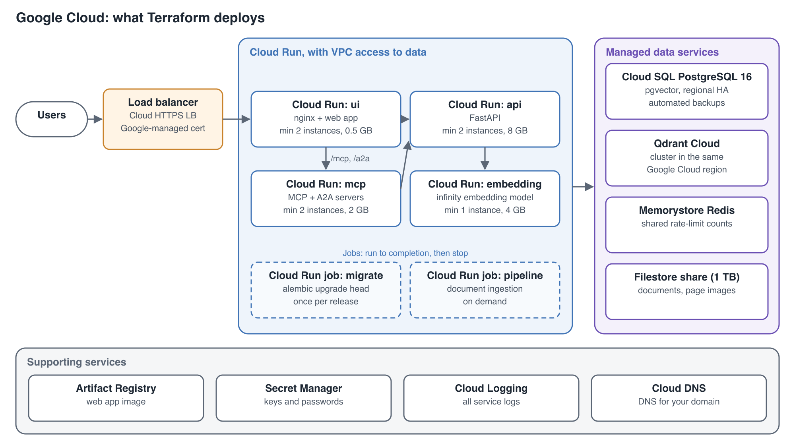

# Example Deployment: Google Cloud

This example runs Evidence Lab on Cloud Run, with Cloud SQL for PostgreSQL, Qdrant Cloud, Memorystore and Filestore behind an external Application Load Balancer. It follows the layout in [Deploying to the Cloud](cloud-deployment.md).

> **Status:** this example is being built. This page describes exactly what it deploys. The Terraform template, the tested commands and the measured running cost are added here once the example has been deployed and tested end to end.

## What the example deploys

| Part | Google Cloud service | Example size |
|---|---|---|
| Network | A VPC network. Cloud Run reaches it with Direct VPC egress; Cloud SQL, Memorystore and Filestore use private addresses in it. | — |
| Load balancer | Global external Application Load Balancer with a Google-managed certificate, sending traffic to the ui service | — |
| ui | Cloud Run service, your web app image from Artifact Registry. Accepts traffic only from the load balancer. | Minimum 2 instances, 1 vCPU, 512 MB |
| api | Cloud Run service, `astrobagel/evidencelab`. Internal traffic only. CPU stays allocated between requests, for streaming answers. | Minimum 2 instances, 2 vCPU, 8 GB |
| mcp | Cloud Run service, `astrobagel/evidencelab`. Internal traffic only. | Minimum 2 instances, 1 vCPU, 2 GB |
| embedding | Cloud Run service, `michaelf34/infinity:0.0.70`. Internal traffic only. | Minimum 1 instance, 2 vCPU, 4 GB |
| migrate | Cloud Run job, run before each release | 1 vCPU, 1 GB |
| pipeline | Cloud Run job, run when you ingest documents | 4 vCPU, 16 GB |
| Postgres | Cloud SQL for PostgreSQL 16, regional high availability, private address only, with the `vector` extension | 2 vCPU, 8 GB, 50 GB SSD, 7 days of backups |
| Qdrant | Qdrant Cloud cluster in the same Google Cloud region | Sized from your collection |
| Redis | Memorystore for Redis, encrypted in transit | Basic tier, 1 GB |
| Documents and page images | Filestore Basic HDD share, mounted at `/app/data` in the api and pipeline | 1 TB, the smallest Basic HDD size |
| Web app image | Artifact Registry | — |
| Keys and passwords | Secret Manager | — |
| Logs | Cloud Logging | 30 days |
| Domain | A Cloud DNS record pointing at the load balancer | — |

Minimum instances keep every service warm. The embedding model takes minutes to load, and the api keeps streaming connections open.

## How the services find each other

Cloud Run services have HTTPS addresses ending in `run.app`. The ui reaches the api and mcp services at those addresses through the VPC. These are the values the example sets, using the settings described in [Deploying to the Cloud](cloud-deployment.md#settings):

| Container | Setting | Value |
|---|---|---|
| ui | `API_UPSTREAM` | The api service's `https://...run.app` address |
| ui | `MCP_UPSTREAM` | The mcp service's `https://...run.app` address |
| ui | `NGINX_RESOLVER` | The DNS server Cloud Run provides |
| ui | `NGINX_REAL_IP_FROM` | The address ranges Google's load balancers connect from |
| api | `FORWARDED_ALLOW_IPS` | The address ranges requests from the ui arrive from |
| api, mcp | `RATELIMIT_STORAGE_URL` | `rediss://<Memorystore address>:6378/0` |
| api, mcp, pipeline, migrate | `POSTGRES_HOST` | The Cloud SQL private address |
| api, mcp, pipeline, migrate | `PGSSLMODE`, `PGSSLROOTCERT` | `verify-full`, and the Cloud SQL instance's server certificate authority |
| api, mcp, pipeline | `QDRANT_HOST`, `QDRANT_API_KEY` | Your Qdrant Cloud cluster's URL and key |
| api, pipeline | `EMBEDDING_API_URL` | The embedding service's `https://...run.app` address |

Cloud Run picks the service by the host name in each request, so nginx must send each service its own host name rather than your domain's. That is a small change to the ui's nginx settings, made together with this example's template.

The api starts with `uvicorn ui.backend.main:app --host 0.0.0.0 --port 8000 --workers 1`, without the migration step. The migrate job runs `alembic upgrade head` first.

## Deploying the example

**You need:**
- a Google Cloud project, and the gcloud CLI signed in to it;
- Terraform and Docker on your machine;
- a domain you can point at the load balancer;
- a Qdrant Cloud cluster in your Google Cloud region, with its URL and API key;
- your model provider keys, and your `config.json`.

**The steps:**
1. Copy the example settings file and fill in the project, region, domain, sizes, Evidence Lab version and the names of your keys.
2. Run Terraform to create the network, databases, file share, registry, load balancer and services.
3. Build the web app image with your settings and push it to Artifact Registry.
4. Run the migrate job and wait for it to finish.
5. Point your domain at the load balancer; the managed certificate is issued once it resolves. Open your domain.
6. Run the pipeline job to ingest your documents.

**Upgrading:** set the new Evidence Lab version, rebuild the web app image, run the migrate job, then deploy new revisions of the services.

**Removing the example:** `terraform destroy` removes everything it created. The Qdrant Cloud cluster is removed in Qdrant's console.

## What the test deployment checks

The example is tested by deploying it into a test project and checking that:
- the site answers over HTTPS;
- search, chat, briefs, sign-in and ratings work, and documents and page images open;
- chat streams for over a minute without being cut off, and an MCP client connects;
- the databases can't be reached from the internet;
- replacing an api instance and failing over the database don't lose data or requests;
- an upgrade causes no downtime;
- a database backup restores;
- tear-down leaves nothing behind.

Running costs are measured during this test and added here.
