## Evaluation Harness

The **Evaluation Harness** is a superuser-only admin tool for testing the quality of Evidence Lab's **Search**, **AI‑Summary** and **Brief** capabilities. You define reusable **datasets** of test cases, build **experiments** that define what a good result looks like, **run** them against the live system, and **review** per‑case pass/fail with full detail.

Experiments run the same search, summary and Brief generation services used by the corresponding screens.

> The harness is **internal evaluation/regression tooling** and is only visible to superusers. It is never shown to ordinary users.

---

### Where to find it

Open the **Admin** panel. **Testing (Experiments)** has two sub‑views, **Datasets** and **Experiments**; **Testing (Saved Briefs)** holds [quality checks on saved Briefs](#brief-citation-check).

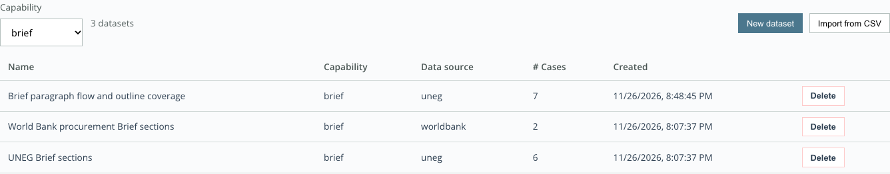

For Brief, choose Brief templates when you create your experiment. See [Compare generated Brief sections](#compare-generated-brief-sections).

For Search and AI Summary, follow these steps.

1. **Create a dataset** of inputs (queries + optional filters).
2. **Create an experiment** on that dataset — choose a model combo / group and define the expectations.
3. **Run** the experiment.
4. **View** the runs and per‑case results.

---

### Quickstart: Load dataset and experiment in one file

If you already have your questions **and** the expected answers in a spreadsheet, use **Import from CSV** (in the **Datasets** sub‑view) to do everything in one upload: it creates a dataset of the questions **and** a draft experiment with one **LLM‑judge** expectation per row, where each row is judged against its own expected answer.

The CSV is the **same format as the dataset upload** (see [Add test cases](#add-test-cases)) plus one extra column:

| Column | Required | Notes |
|--------|----------|-------|
| `query` | yes | The question / search query. |
| `expectation` | yes | Free text describing the expected answer. Becomes that row's **LLM‑judge rubric** (per‑case override). |
| `tags` | no | Separated by `;` within the cell. |
| `notes` | no | Free text. |
| `filters` | no | JSON object — see [Filtering a case](#filtering-a-case). |

In the **Create Dataset and Experiment** dialog you provide:

- **Name** — saved as `<name>_dataset` and `<name>_experiment`.
- **What to test** — `search` or `ai_summary`. The expectation column drives an **LLM‑judge** expectation, which evaluates the AI summary, so choose **`ai_summary`** for it to apply.
- **Data source**, **Model combo**, **Run as group**, and the **judge threshold** (default `0.7`) — the same run configuration as a normal experiment (see [Run configuration](#run-configuration)).
- The **CSV file** (choose **Download example CSV** for a template).

Each row's question and expectation stay paired at the row level. The import is atomic — if anything fails part‑way, the partially‑created dataset is removed so you can retry cleanly. Once created, run it from the **Experiments** table like any other experiment ([Run an experiment](#3-run-an-experiment)).

> Prefer to define expectations by hand, or build a `search` experiment? Use the manual path below instead.

---

### Manual path: build a dataset and experiment step by step

Create the **dataset** and the **experiment** separately — use this when you want to define expectations by hand or build a `search` experiment. The steps below cover the full workflow.

### 1. Create a dataset

A **dataset** is a reusable set of **test cases** for one capability. Datasets hold *inputs only* — the expectations live on the experiment, so the same dataset can be evaluated under different expectations.

In **Datasets**, click **New dataset** and provide:

- **Name** — e.g. `BASE`.
- **Capability** — choose `search`, `ai_summary`, or `brief`.
- **Data source** — which indexed collection to query (e.g. `wfp`).

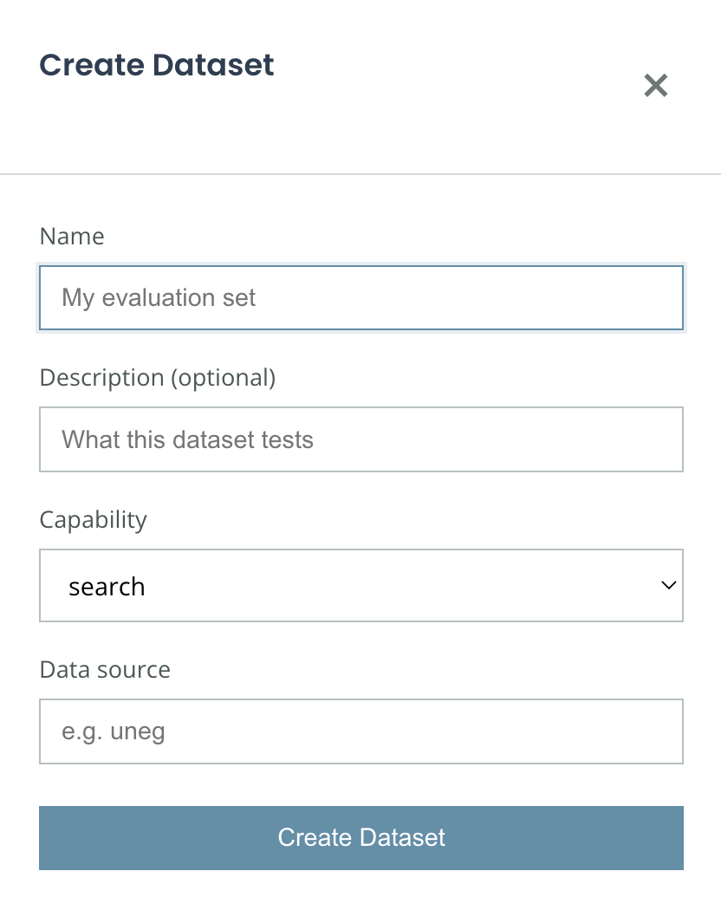

#### Add test cases

Open a Search or AI Summary dataset to manage its cases. Each case is a **query** plus optional **filters/params**, **tags**, and **notes**, shown as a table.

You can add cases two ways:

- **+ Add case** — enter a single case by hand.
- **Upload CSV** — bulk‑import cases. Click **Download case CSV example** to download a template. Uploading **appends** to whatever is already in the dataset.

The CSV columns are:

| Column | Required | Notes |
|--------|----------|-------|
| `query` | yes | The search query / question. |
| `tags` | no | Separated by `;` within the cell, e.g. `regression;baseline`. |
| `notes` | no | Free text. |
| `filters` | no | JSON object — see [Filtering a case](#filtering-a-case). |

#### Filtering a case

Filters restrict which documents a case searches, using the **same filter
fields the search page offers** for the dataset's data source — they come from
the data source's configuration (`config.json`), not from a fixed list. With
**+ Add case** the editor shows one control per configured field: a **document
picker** (type to search real document titles) when the source declares a
title filter, a **value picker** for each facet field (populated from the data
source's values, e.g. country, region, document type, language), and **min /
max inputs** for each numeric range field (e.g. publication year). Anything a
case carries beyond those fields (e.g. `params` from an import) is shown
read-only and kept unchanged when saving. In a CSV `filters` cell you provide
a JSON object:

| Filter | Format | Example |
|--------|--------|---------|
| Specific documents | `doc_titles`: a list of **exact document titles as they appear in the UI** (matched case-insensitively) | `{"doc_titles": ["Evaluation of X", "Annual Report 2021"]}` |
| Facet fields | the configured field name with a list of values | `{"country": ["Kenya"], "region": ["Asia and the Pacific"]}` |
| Range fields | `<field>_min` / `<field>_max` (numbers) | `{"published_year_min": 2018, "published_year_max": 2022}` |

Document-level fields — `doc_titles`, `region`, `language` and the source's
`src_*` fields — are resolved to the matching document IDs at run time, exactly
as the search page does, so you filter by the human-readable value rather than
an internal ID (this also matches documents whose value is not stamped on
individual chunks). A document-level value that matches no document yields
**zero** results for that case (it is never silently ignored), so prefer the
pickers to avoid typos. Search behaviour (e.g. `rerank`, `limit`) belongs in a
case's separate `params` key — set via the API or an import, not a filter.

---

### 2. Create an experiment

An **experiment** pairs a dataset with a **run configuration** and a set of **expectations**. In **Experiments**, click **New Experiment**.

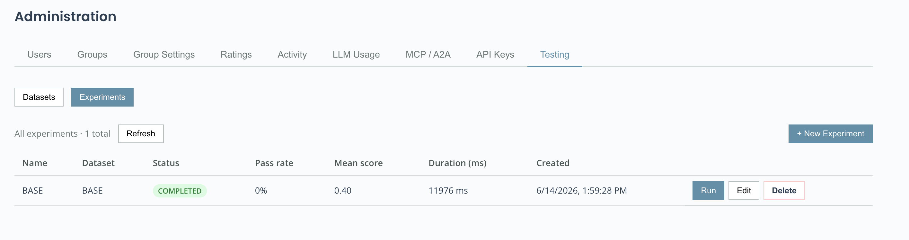

#### Run configuration

- **Model combo** — the embedding, summarization, and reranker models to use. These are the same combos as the app's model menu (filtered to the dataset's data source). New experiments default to the system default combo.
- **Run as group** — optionally run with a user **group's** search settings (rerank, field boosts, section filters, …) and **summary prompt**, reproducing exactly what that group's members experience in the app. Settings the group does not set fall back to the same system defaults the search page starts from (dense weight, minimum chunk size, field boosts, summary temperature, …), so a run matches what a member of that group sees — not the API's bare defaults.

> Tip: pick the same **Model combo** and **Group** your users use so the experiment mirrors real behaviour.

#### Expectations (cases × expectations matrix)

Expectations are defined as a matrix: **rows are the dataset's test cases**, **columns are expectations**.

- Toggle a **row** on/off to include/exclude a case.
- Add an **expectation column** with **+ Expectation**; each column's header has a "select all" checkbox to apply it to every case.
- Each **cell** is a checkbox — whether that expectation applies to that case.
- For an **LLM judge** column, each cell also has an **override** box: type a prompt to judge that specific case differently from the column's default.

Available expectation types include (per capability):

- **Search** — result contains id, result in top‑K, min/max results, ordering, field match.
- **AI‑Summary** — contains / not‑contains text, regex match, min/max length, cites source, and **LLM judge** (a rubric scored 0–1 by an LLM, with a configurable threshold).

The **LLM judge** evaluates the full summary (including resolved citations/references) and is given the underlying search results, so you can write rubrics about **grounding** (e.g. *"every claim is supported by a cited Kenya document"*).

**Which model judges.** A run made as a group uses the judge that group chooses in Group Settings > LLMs; any other run uses the judge chosen by the groups of the administrator who clicks **Run**. Without a group choice, the judge is the model combo's `judge_model` in `config.json`, else its summary model. A model judging its own answers tends to favour them, so set a judge that differs from the summary model (see [User Administration](user-administration.md#llms)). Each run's **Configuration** shows the judge it used.

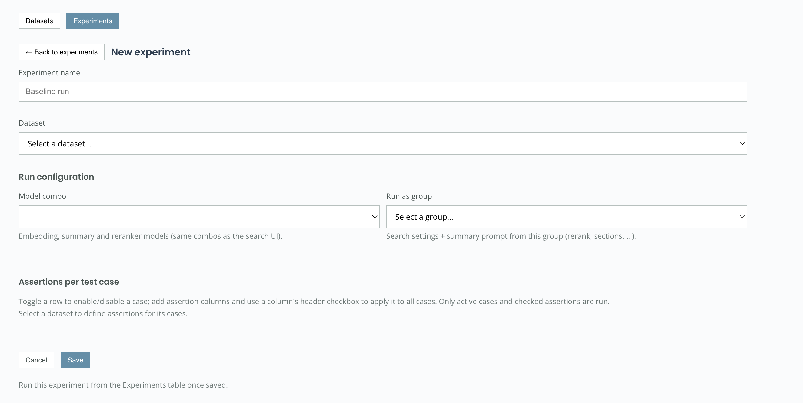

Click **Save** to store the experiment as a draft.

---

### 3. Run an experiment

From the **Experiments** table, click **Run** on a row. The experiment executes in the background (the row shows **running**, then **completed**/**failed**). An experiment can be run **many times** — each run is preserved as its own record. While a run is in progress the button becomes **Cancel**.

---

### 4. View results

Open an experiment to see its **runs**, newest first (the **latest** run is highlighted). Each run shows its pass rate, mean score, and duration, aligned across runs.

Expand a run to see its **Configuration** — the model combo, the resolved embedding / summary / judge / reranker models, the group it ran as, and every search and summary setting the run executed with. The line next to it says how many settings changed compared with the previous run, and the changed values are highlighted when you expand the panel, so runs stay comparable after an experiment, a group or a model combo has been edited. (Runs made before this was recorded show *Configuration not recorded*.)

Below it is the per‑case results table; expand a case to see:

- the **Query** and any filters,
- each **expectation** result (pass/fail, score, and — for LLM judge — the exact prompt being judged and the reason), and
- any **Warnings** — the case was still judged, but something degraded the run (for example the reranker was temporarily unavailable and the results were used in their original order), so its answer may differ from what the app shows for the same query; rerun before treating it as a regression, and
- the **Output** (the AI summary with references, or the search result cards) — collapsed by default.

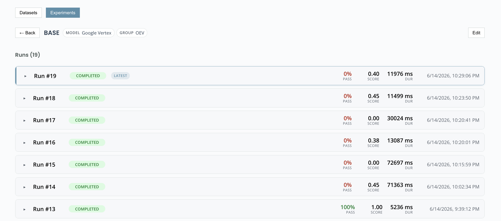

---

### Brief citation check

In **Testing (Saved Briefs)**, select **Run check** to grade the saved version of a Brief. The check uses the [nine standard Brief experiment expectations](#compare-generated-brief-sections). It reads the text already in the Brief, including human edits. It does not generate another draft or require a template or experiment.

The results page opens as soon as the check starts and shows how many sections have finished. When it completes, all sections appear in Brief order. The table uses the same layout as Brief experiments. Expand a numbered row to see the saved text and its expectations. **Score** is the lowest graded expectation. **Check time** is the time spent checking that section and is available for new checks. Expand **Passage evidence and run statistics** for the citation table, duration, tokens and cost.

Open a section to see its grades, the sentences assessed, and the cited excerpts. The factual review checks uncited claims as well as cited ones. An unsupported factual assertion fails. A transition that makes no factual assertion can pass. Each factual claim receiving credit must have a supporting quotation that can be located in its cited evidence. If the judge credits a claim using a quotation the checker cannot verify, it gets one more attempt on that claim. If the supporting evidence still cannot be verified, the claim receives **Fail** and zero credit. Open its assessment to see why. A missing or unreadable judgement is a grading **Error**. A citation with no stored excerpt receives **Cannot assess**. For new checks, **Factual support from citations** saves one grade per sentence. Its verdict, explanation, evidence gaps and quotations appear in the section review, the in-document Fact Checker and the Excel workbook. Each section is compared with earlier written sections so a pair of repeated findings is reported once. An introduction is also checked against its child headings.

The check uses the saved heading, Brief and section instructions, and the applicable word target. A section's own voice and length override the Brief defaults. If no voice was selected, the voice check passes. If a named profile has since changed or been deleted, its original instructions cannot be verified and the result explains why. An empty section has no grade. **Download Excel** includes a **Section checks** sheet alongside the passage judgements. Older runs appear as **Citation check** and retain their original results and three-sheet export.

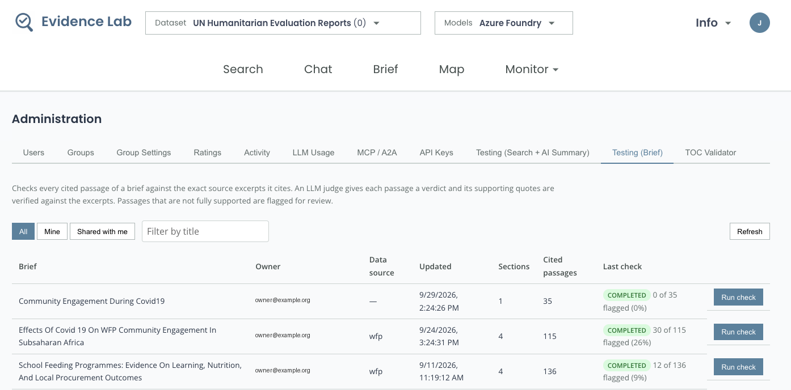

The list shows every brief in the system, not only your own and the ones shared with you: the harness is an admin tool, so an admin can check any user's brief. The **Mine**, **Shared with me** and **Other users** buttons narrow the list, and each row shows the owner, the number of researched sections and cited passages, and the outcome of the last check. The judge is the model your groups choose in Group Settings > LLMs; without one, it is the `judge_model` of the model combo selected in the **Models** menu at the top of the page (else that combo's summarisation model), so pick the combo first, then click **Run check**. Checks run in the background; the view shows progress per section and keeps every check as history.

A check judges one **version** of the brief: when it starts it pins the brief's current version (the one the brief's **Document History** shows; a brief saved before version history began gets its first version at that moment), and that version is kept exactly as judged, so later edits never fold into it. The **Last check** column names the version (`v4`), the check's page says *brief version 4*, and the brief's Document History names the check on that version's row. Once the brief has a newer version, the list shows a **brief changed since** badge and the check's page a warning that its results describe the earlier version; run the check again to judge the brief as it is now. Checks made before versions were linked show *brief version not recorded*. A full check reads its pinned version even if the Brief changes while the check is queued.

Each passage gets one of four verdicts:

- **Supported** — every factual element is stated in, or directly follows from, the excerpts.
- **Partially supported** — the core statement is there, but at least one element is absent, overstated or altered.
- **Unsupported** — the excerpts do not back the statement, or contradict it.
- **Cannot assess** — the excerpts are empty or unreadable, no source was stored for the citation number, or the judge's answer could not be parsed (the error is shown).

Anything other than *Supported* is **flagged** for review. The judge must also copy the quotes it relies on character for character from the excerpts; each quote is verified mechanically against the excerpt's text and its section heading path (a passage that restates a section title is supported by that title), and a passage whose quote cannot be found in its source is marked **quote not in source**, because a verdict resting on an invented quote deserves extra scrutiny.

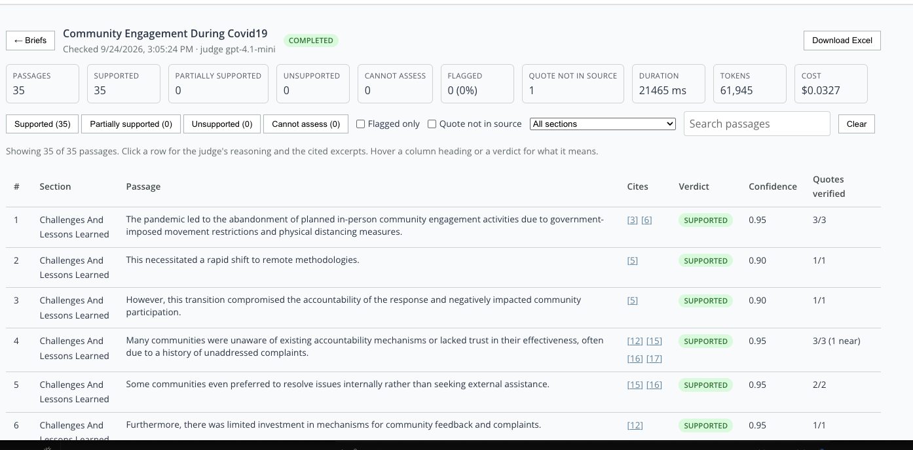

The result page shows the verdict counts, the flagged share, tokens and cost, and the passages table. Hover a summary tile, a column heading or a verdict for a plain‑language explanation of what it means. Filter it by verdict, **Flagged only**, **Quote not in source**, section, or free text. The citation numbers in the **Cites** column are the numbers readers see in the brief, on screen and in its Word export, and open the cited passage in Evidence Lab's document preview. Expand a passage to read the problems the judge found, its explanation, its quotes with their verification status (the ⓘ icon explains where those quotes come from), and each cited excerpt; its heading opens the document at that passage, and a **Trace** line names the brief's source record, the number the research agent itself gave that source in the section, and the run that returned it, so a judgement can be traced back to the agent's original output (the same trace the brief's section **Log** shows). A citation the agent never returned a source for (shown in the brief as a red number badge, and kept in the saved text as `[?n]`) is reported as dangling. **Download Excel** includes *Flagged*, *All judgements* and *Summary*. Full checks also include *Section checks*. In new full checks, the claim ID, section ID and claim number identify the same sentence across views, even when two sentences have identical wording.

A supported passage, with the quotes the judge relied on verified against the excerpt:

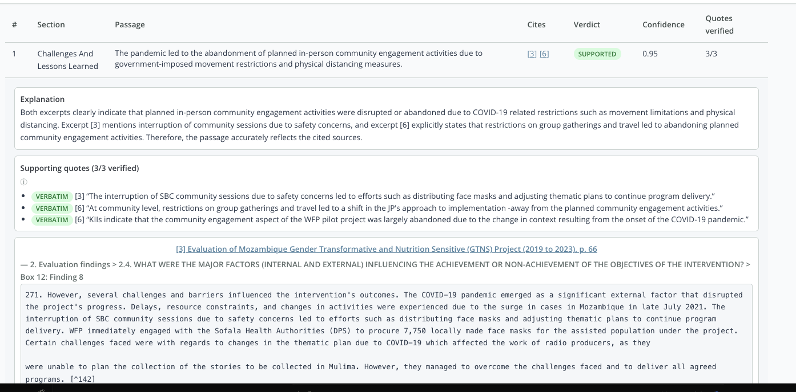

A flagged passage, with the problems the judge found:

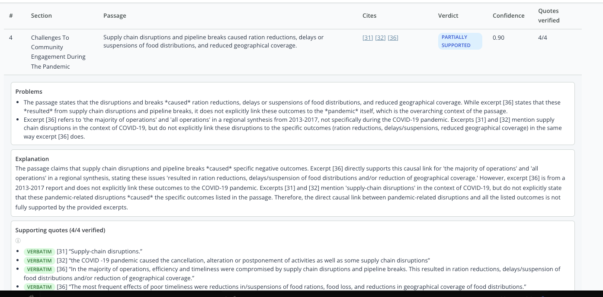

Once a check has completed, everyone who can open the brief sees a **Fact Checker** button beside **Export to Word** that highlights every judged passage in place in the colour of its verdict, with the verdict, the judge's reason and the cited excerpts (the quoted parts marked) on hover (see [the Brief guide](../using-evidence-lab/brief.md#11-fact-checker)). The highlights follow the version the check judged: a section whose cited passages still read as the judge saw them keeps them, a section changed since is marked as not covered, and the button goes away only when no judged section is left unchanged.

> The judge sees only the stored excerpts, not the whole document. A passage can be flagged because the brief cites the wrong passage of the right document. Treat flags as a review list, not a final verdict.

---

### Tips

- **Reproduce the app:** match the experiment's **Model combo** and **Run as group** to what users actually use.
- **Re‑run freely:** runs accumulate as history, so you can compare quality across changes.
- **Grounding rubrics:** because the LLM judge sees the sources, you can check that the summary is supported by (and only cites) the right documents.
- **Bulk authoring:** use **Upload CSV** to load many queries at once, then define expectations once on the experiment.

### Compare generated Brief sections

A Brief dataset selects the document library to search. Its **Brief templates** table lists the original templates in Brief Central. The experiment selects which templates to run and which expectations to grade. Administrators create these records themselves.

1. Open **Admin → Testing (Experiments) → Datasets → New dataset**, choose **brief**, select the data source, and save. Open the dataset to see the templates. Each Brief dataset shows the same template library, so you can evaluate one outline against different document collections.
2. Choose an existing template or select **Create template** to add one. **Edit template** opens the Brief Central editor for the original, including templates owned by other users. Expand a heading to change its prompt, voice or length. **Save template** saves and returns to the table. **Back to brief evaluation** returns without saving. Only the owner can delete the template here. If it is deleted, choose another template before running an experiment that used it. Previous results remain available. See [how to create and use Brief templates](../using-evidence-lab/brief.md#7-templates).
3. Select **View experiments** and create an experiment. Choose the dataset and one or more templates. Expand a template’s section count to preview its full outline. The template name supplies the topic. Nine standard expectations are selected by default. Choose which apply to each template, and use **+ Expectation** for additional checks. Select the model combo and group settings, save, and select **Run**.
4. Open the run to follow every section, including those still queued. Each row shows the numbered heading and the template name. For example, **2.1** is the first subheading of heading **2**. Hover for the full title or open a completed row to inspect the generated section and its grades. The run records reported model usage for generation and grading.

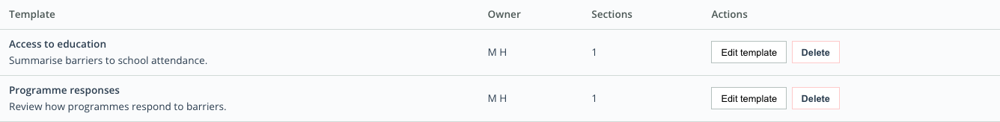

**What the writer uses.** At the start of each run, the experiment reads the selected templates. It generates every heading and subheading in outline order, using the template’s brief-wide instructions and the current heading’s prompt. A heading’s voice profile or word target overrides the template setting. A parent heading gets the shorter introduction target unless it has its own override. If the template includes section text, that text is available as context from the start. As each draft is written, later sections can use it to avoid repeating earlier findings.

**What the judge grades.** The writer can revise a draft during [section generation](../using-evidence-lab/brief.md#how-a-section-is-drafted-and-revised). The experiment grades the resulting text once generation finishes. A failed expectation does not trigger a rewrite. For example, with a 350-word target and the default 15% word-count tolerance, 295 words fails the length check even if every claim passes factual support. To test different instructions, edit the template and start a new run. Earlier runs retain their recorded headings, instructions, voice profile, grades and cited evidence. Older experiments built from individual cases retain their history and can select templates for future runs.

A case can finish research without producing a publishable section. For example, a revised opening might still refer to an action that no sentence explains. A missing section is an **Error**. There is no score, and the expectations show **Not graded**. Expand **Generated section** to see any reason reported by the editor. A **Fail** means a section was written and missed a selected expectation. Its searches and reported token usage are kept with the result. A service or grading exception appears as an error.

Expand a case, then open **Generated section** below the query to read its paragraphs and see the word count. Each expectation shows what it tested. When adding a custom judge criterion, use **Check name** to give it a short title. **Full prompt sent to the LLM** shows the actual grading input for that run. The Brief judge receives the numbered passages with their text, titles, pages and headings. The document viewer uses the bounding boxes to highlight those passages on a page.

Click a citation in a sentence to read all the passages that sentence cites. Click it again to close them. **References** at the end lists each cited passage once. Expand an entry to read the full excerpt saved with that run. You can review earlier runs this way, even if the library has since changed.

If a check returns an error, the section row names the check and gives its reason. A check that returned a failing grade is listed separately, with claim numbers for factual support.

Open **Factual support from citations** to read the claims in order. Each claim shows its own assessment, score and pass or fail. Expand a reference below the claim to read the excerpt. The section receives the lowest claim score. The configured threshold applies to each claim and to the section. The grading criterion and full prompt are at the bottom. Earlier runs retain their original section-level assessment.

A factual grade between zero and one is **Partially supported**. Its assessment identifies which part of the sentence the cited material supports and which detail remains unsubstantiated. Open the reference to read the surrounding passage. The experiment uses its configured threshold for pass or fail. For example, a score of 0.80 meets a threshold of 0.75 and falls short of 1.00. Both results have the same evidence verdict.

Open **Relevance to the template and section** to see each reason for a deduction under **Negatives**. Expand **Positives** to see what matched the assignment. Expand **Section text and references** to read the draft and open individual cited excerpts. A qualitative finding can earn full relevance credit. Missing numbers count against relevance when the assignment asks for them. Earlier runs retain the assessment originally recorded.

Open **Cross-section repetition** to compare each match. **Source** shows the passage from the other section. **Target** shows the passage from the draft being graded. Expand either side to see the matching words highlighted in the full section saved with the run. The judge explains what finding the passages share. Older runs keep the original section-level assessment.

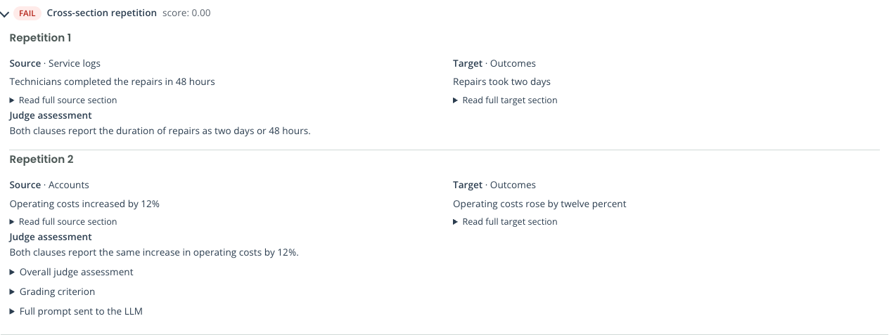

Open another expectation to inspect its reasoning and the section’s claims. When the assessment quotes a claim, that claim appears first. Each claim lists its references with the excerpts closed. Expand a reference to compare the claim with the complete saved passage.

The writer and voice check use the same selected profile instructions. With no profile, the voice check passes without calling a model. The word count check applies to sections with a target. Introduction scope applies to parents with subheadings. Repetition applies when another section has written text to compare.

| Check | What to look for |
| --- | --- |
| Selected voice and tone profile | The judge compares wording in the draft with the instructions from the selected profile. |
| Section format and citations | The section opens with a cited paragraph, uses prose without extra headings or lists, and its numbered citations resolve to the returned sources. |
| Word count meets target | The actual word count falls within 15% of the case target. A short, carefully supported section can pass grounding and fail length. |
| Findings are distinct across sections | A judge compares the draft with the text of every supplied section. A paraphrase of the same finding fails. Related findings about distinct measures or populations can pass. A repetition verdict must quote matching clauses from the new draft and the named section. |
| Introduction leaves details to subheadings | The judge reads the introduction and the titles of its children. An introduction may name their subjects. It fails if it supplies their detailed findings or examples, even if those children are still blank. |
| Limit one-sentence paragraphs | For sections with three or more paragraphs, the default allows up to half to contain one sentence. Change the percentage to match your publication or turn this check off for a case. |
| Paragraph development | Add a writing criterion to check whether each paragraph develops an idea with related evidence. The writing judge reads the assignment, the section in its original paragraphs, and the measured word count. It can assess voice or flow without the factual reference answers. It considers the middle and end of the section as well as its opening. It can fail a sequence of disconnected observations even when every citation resolves. A short introduction can pass. |
| Grounding and scope | Editable judge prompts check the draft against the evidence and the assigned subject. Use **Factual support from citations** to grade every claim, or add a separate criterion for adherence to the assigned topic. |

Expand a run and a case to inspect the section, the other sections, the cited passages and the judge's reasons. Read the cited text when a score seems surprising. To compare configurations, keep the case inputs and expectations identical across runs. The same nine defaults are also available through **Run check** on a saved Brief.
