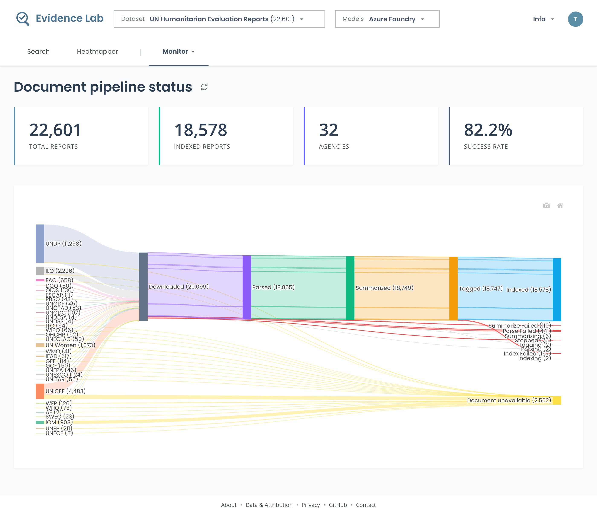
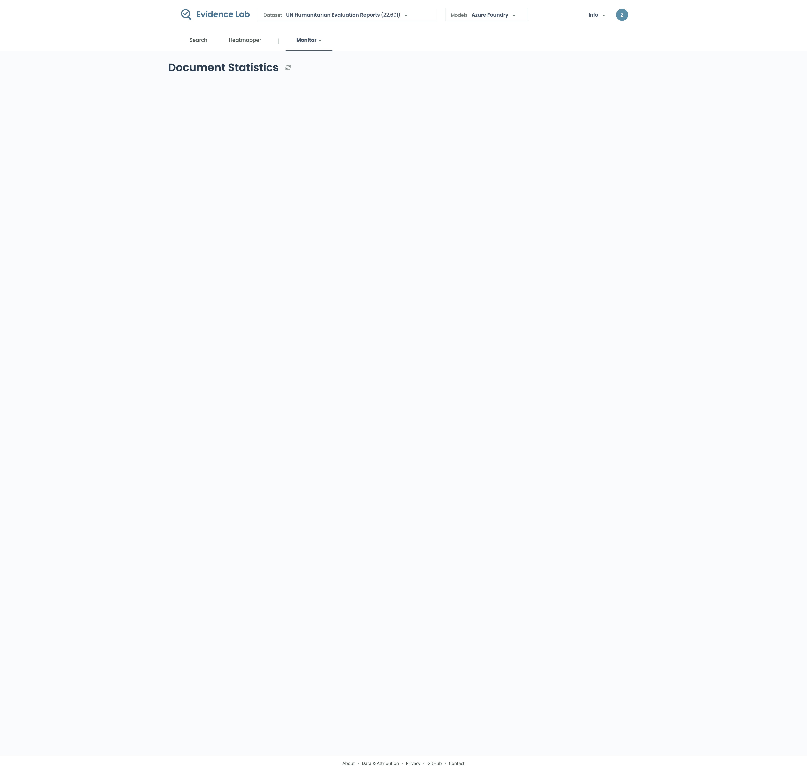
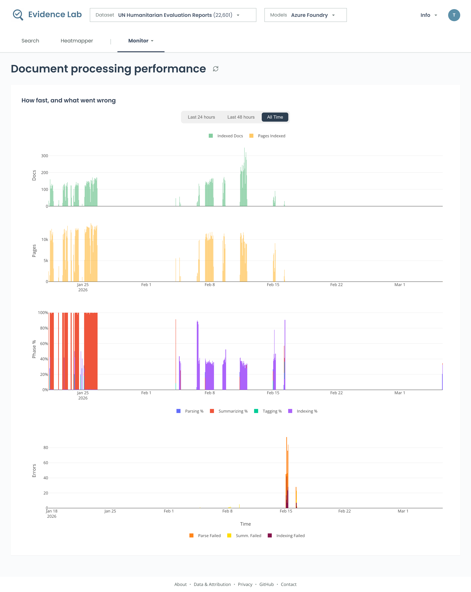
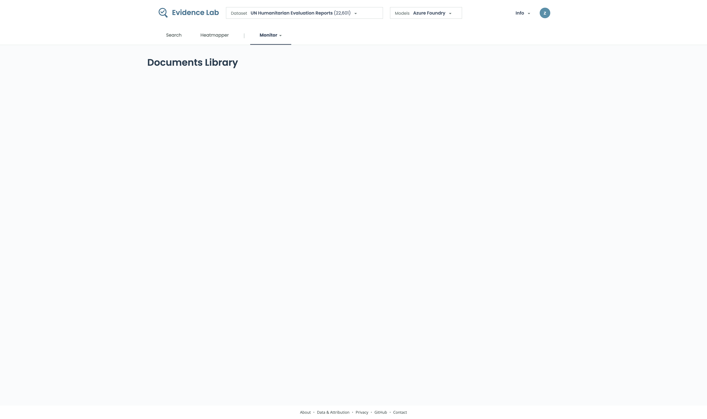
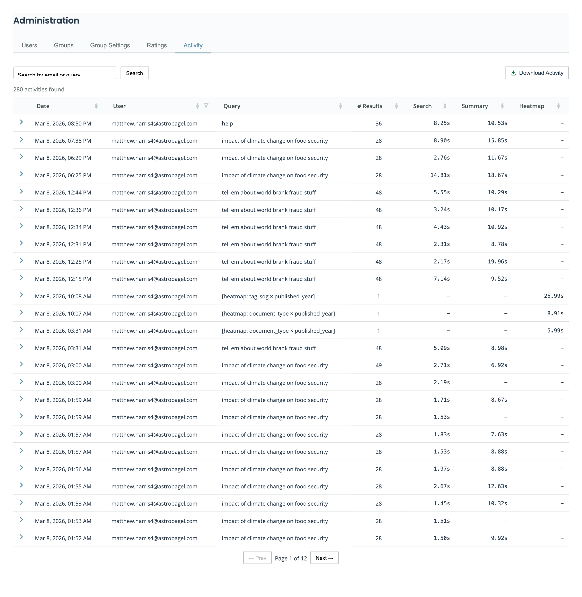

## System Monitoring

Evidence Lab provides built-in monitoring tools to track pipeline performance, document processing, corpus statistics, and user activity. Access them from the **Monitor** dropdown in the top navigation bar.

---

### Pipeline View

The Pipeline view gives you a high-level overview of your document processing status.

**Key Metrics Cards** — four summary cards at the top show:
- **Total Reports** — total document count in the corpus
- **Indexed Reports** — successfully processed and searchable
- **Agencies** — number of publishing organizations
- **Success Rate** — percentage of documents that made it through the full pipeline

**Sankey Diagram** — the flow chart below shows how documents move through each processing stage: Organizations → Downloaded → Parsed → Summarized → Tagged → Indexed. Error branches (Parse Failed, Summarize Failed, etc.) are shown as side flows so you can quickly spot where documents are dropping out.

Hover over any node or link in the diagram to see detailed counts and tooltips.

---

### Stats View

The Stats view shows interactive bar charts breaking down your document corpus by different attributes.

Toggle between seven breakdown views using the buttons at the top:

| View | Shows |
|------|-------|
| **Year** | Documents by publication year |
| **Type** | By document type |
| **Organization** | By publishing organization |
| **Language** | By document language |
| **Format** | By file format |
| **Country** | By country covered |
| **Status** | By processing status (indexed, parsed, error, etc.) |

Each bar is color-coded by processing status. Click any bar to jump to the Documents view pre-filtered to that category.

---

### Processing View

The Processing view shows real-time performance metrics for your pipeline.

Toggle the time range: **Last 24 hours**, **Last 48 hours**, or **All Time**.

Three charts are shown:

1. **Throughput** — dual-axis bar chart showing indexed documents and pages indexed per time bucket
2. **Phase Distribution** — 100% stacked bar chart showing how processing time is split between Parsing, Summarizing, Tagging, and Indexing
3. **Error Chart** — stacked bar chart showing error counts by type (parse failed, summarization failed, indexing failed)

---

### Documents View

The Documents view is a full document library with detailed inspection tools.

Features include:

- **Sortable, filterable table** — columns for title, organization, year, type, status, and more
- **Free-text search** — find documents by title or metadata
- **Export to Excel** — downloads the page currently on screen as a spreadsheet, the same rows in the same order after sorting and filtering, so the **Per page** setting decides how many rows you get. Three columns carry more than the table shows: the whole AI summary rather than the preview, the document's table of contents from the **Contents** link, and the full document record from the **Metadata** link as JSON. Each AI tag taxonomy (SDG and any others configured) gets its own column holding the complete tags as JSON — code, name and the model's reason — not just the codes. The status logs, the processing timeline and the chunks are not exported; they are per-document detail rather than properties of the row.
- **Column filter popovers** — click any column header to filter by specific values
- **Server-side pagination** — efficiently browse large corpora; **Per page** beside the page buttons shows 5, 10 (the default), 50 or 100 documents a page, and is kept in the link (`page_size`)

Click any document row to access detailed inspection modals:

| Modal | What It Shows |
|-------|---------------|
| **Summary** | The AI-generated summary, with how, when and by whom it was made; administrators can edit or regenerate it (see [Document Summaries](document-summaries.md)) |
| **TOC** | Table of contents with section classification; administrators can correct the classification, approve it or run it again |
| **Metadata** | Full document metadata including source fields |
| **Processing Timeline** | Stage-by-stage processing history with timestamps |
| **Processing Logs** | Raw processing output and error messages (administrators only) |
| **Chunks** | Vector chunks with PDF viewer overlay |
| **PDF Preview** | Inline PDF viewer |
| **Taxonomy** | AI-assigned taxonomy tags with confidence |
| **Reprocess** | Re-trigger the processing pipeline for this document (administrators only) |

Administrators can also tick documents and **Regenerate summaries** for all of them in a queue; see [Document Summaries](document-summaries.md).

Correcting or re-running a table of contents, reprocessing a document, the processing queue and the processing logs are for signed-in administrators. Other users do not see these controls, and the API refuses them, so a deployment without sign-in cannot use them from the app; run the pipeline from the command line instead (see [Pipeline Configuration](pipeline-configuration.md)).

---

### User Activity (Admin)

Administrators can track all search activity from the **Admin Panel → Activity** tab.

The Activity panel shows:

- **Searchable, sortable table** — columns for Date, User, Query, number of Results, Search time, Summary time, and Heatmap time
- **Filter by user** — narrow down to a specific user's activity
- **Expandable rows** — click any row to see the complete detail:
  - **URL** where the search was performed
  - **Filters applied** — every search parameter the user set
  - **Timing breakdown** — search, summary, and heatmap durations
  - **AI Summary** — the full generated summary with citations
  - **Research Tree** — if the user explored sub-topics, the full drilldown tree is shown
  - **Search Results** — snapshot of the results the user saw
  - **Heatmap Data** — for heatmap searches, the full cell count cross-tabulation
- **Export to Excel** — click **"Download Activity"** to export all activity as an XLSX file

The export includes: Date, User Email, User Name, Query, Results count, Search/Summary/Heatmap timing, AI Summary text, URL, Has Ratings flag, and Search ID.

> **Privacy note:** Activity logging works for both authenticated and anonymous users (anonymous users are tracked by session ID). All activity data is automatically anonymized when a user deletes their account.

### LLM Token Usage (Admin)

The **Admin Panel → Token Usage** tab rolls up LLM token consumption and cost
from the activity log, bucketed by day / week / month and grouped by user or
user group, with an optional activity-type filter and XLSX export.

Token usage is recorded **server-side at the source**: the backend writes (or
accumulates onto) the activity row the moment an LLM call finishes, so every
token-consuming part of the system is covered — not just calls made from a
browser tab. Tracked activity types:

| Type | What it covers | Attributed to |
|------|----------------|---------------|
| `search` | Search AI summaries, including drill-down summaries (accumulated onto the search's row) | The searching user / session |
| `assistant-basic` / `assistant-deep-research` | Research assistant turns (all internal agent steps summed) | The chatting user / session |
| `brief` | One row per brief, accumulating outline generation, per-section deep research, and section edits | The brief's author |
| `highlight` | Semantic highlighting LLM calls, accumulated per originating search | The viewing user / session |
| `evaluation` | One row per evaluation run (AI-summary + LLM-judge calls, also visible per run in the Evaluation tab) | The admin who clicked **Run** |
| `a2a-assistant` | Research assistant calls made through the A2A protocol server (the MCP server directs research to A2A; `mcp-assistant` is reserved for a future MCP research tool) | Anonymous; the caller's API identity is kept in the row's filters |
| `translation` | Translations made with the deployment's LLM (`TRANSLATION_PROVIDER=llm`) | Anonymous |
| `pipeline` | Ingestion stages (summarization, TOC classification, taxonomy tagging) — one row per document per stage | Anonymous; stage, data source, and document id are kept in the row's filters |

Cost (USD) is computed server-side per call from the pricing table in
`ui/backend/utils/llm_costs.py`, keyed by the `supported_llms` model key.
Models without a configured rate (e.g. self-hosted HuggingFace models) show
token counts with a "—" cost.

> **Not metered:** embedding and reranker calls. Rerankers report no token
> counts, and the embedding client does not currently expose the provider's
> usage envelope — both are candidates for a follow-up.

### Daily AI limit

`AI_DAILY_COST_LIMIT_USD` is the most the site's AI features may cost in one
UTC day, in US dollars, priced as the Token Usage tab prices them. Set it on
the api and the MCP server (they share the day's total). Unset means no limit;
`0` turns the AI features off.

- **What stops.** Once the day's total reaches the limit, every AI request is
  refused until 00:00 UTC with *"Today's AI allowance for this site has been
  used. Search still works; AI features return at 00:00 UTC."* (HTTP 429 with
  `Retry-After`). That covers search summaries, the research assistant and
  brief sections, brief outlines and edits, document summaries, LLM
  translation, the admin evaluation runs and brief checks, and the MCP and A2A
  assistant. Semantic highlighting is left out and keyword highlighting carries
  on. Search, browsing and the heatmap keep working.
- **What counts.** The cost of every AI call the api and the MCP server make,
  added to that UTC day's total (`ai_daily_spend`) as each call is recorded.
  Pipeline runs are neither counted nor stopped, because stopping one midway
  would mark its documents failed; watch them with your cloud's usage alarms.
  Embedding and reranker calls add nothing. A call is priced by the model's
  `supported_llms` key, whether the request names the model by that key, by
  the provider's model id (such as `us.amazon.nova-2-lite-v1:0`) or not at
  all, which means the default model.
- **Nobody is exempt**, administrators included: raise the limit instead.
- **It can run a little over.** A request is checked when it starts, and its
  cost is added when it finishes, so requests already running when the limit
  is reached, including long deep-research questions and evaluation runs,
  carry on. Each copy of the api reads the total at most every 30 seconds.
- **When it is reached**, the first refused request of the day logs a warning
  starting `AI daily limit reached`, with the day's total and the limit. On AWS,
  the template turns that line into an email to `alert_emails`.
- **It stops start-up when it can't be counted.** A value that isn't a number
  of dollars stops the api and the MCP server at start-up. So does a model
  that has no price, because the limit could not count its use: one in
  `supported_llms` (which includes every model a group can choose in Group
  Settings > LLMs), one a model combo names (its judge too), or the default
  model (`LLM_MODEL`, or the `llm` model in config.json's `application`
  section). The error names each such model and where it is set: give it a
  `price_per_million` in its `supported_llms` entry (see [Pipeline
  Configuration](pipeline-configuration.md#llm-models-supported_llms)), add
  its price to `ui/backend/utils/llm_costs.py` under its `supported_llms` key,
  or stop using it there. A `price_per_million` in config.json takes
  precedence over that file, so a deployment can price its own region. The Hugging Face models in the stock config.json have no
  price.
- **A call that still has no price is logged.** While the limit is set, any AI
  call the api or the MCP server can't price logs an error starting
  `AI call not counted towards the daily AI limit`, naming the model.
