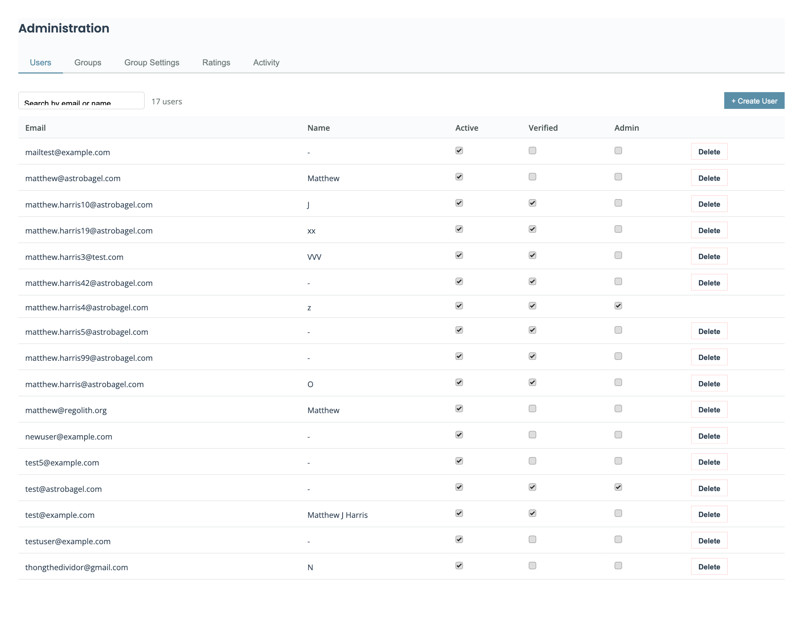
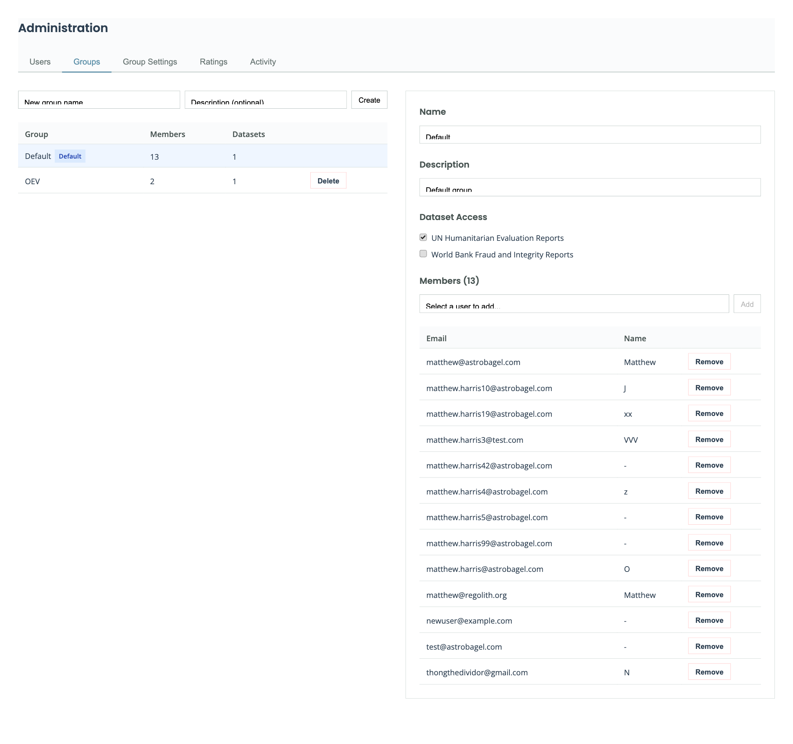
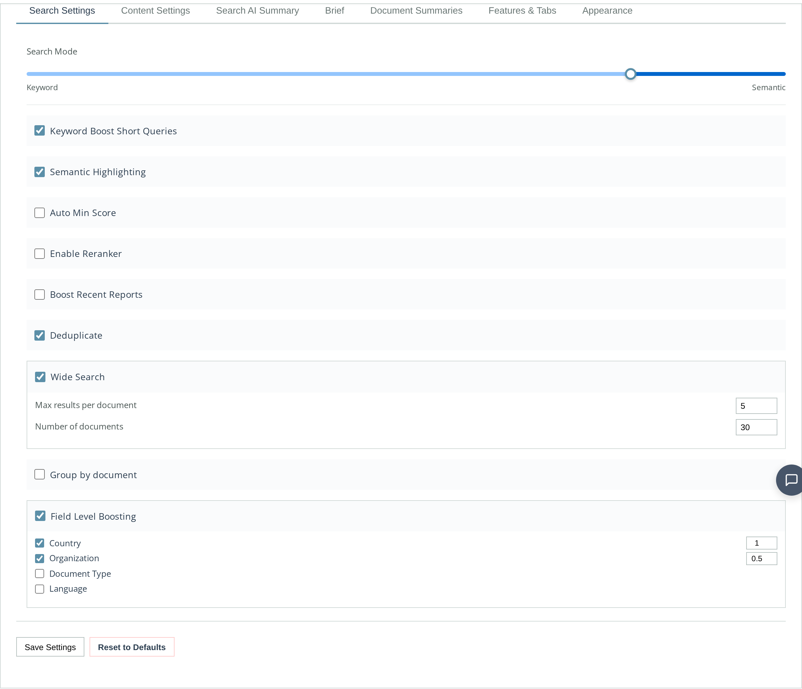
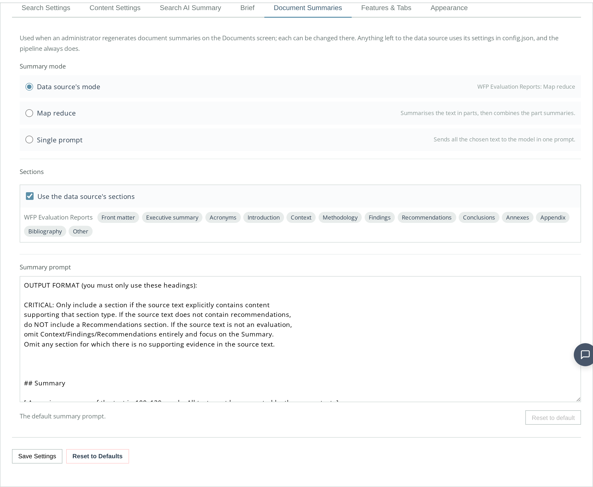

## User Administration

Evidence Lab includes a full authentication and authorization system built on [fastapi-users](https://fastapi-users.github.io/fastapi-users/). This guide covers setup, authentication methods, user and group management, and the admin panel.

---

### Authentication Modes

Control authentication behavior with the `REACT_APP_USER_MODULE` environment variable in `.env`:

| Mode | Behavior |
|------|----------|
| `off` (default) | No authentication — everyone has full access |
| `on_passive` | Sign-in is available but optional; anonymous users can browse freely |
| `on_active` | All access requires login |

---

### Setting Up Authentication

#### 1. Email/Password Authentication

Email/password registration works out of the box once you enable the user module. Key environment variables:

```env
REACT_APP_USER_MODULE=on_active
FIRST_SUPERUSER_EMAIL=admin@example.com    # Auto-creates the first admin account
FIRST_SUPERUSER_PASSWORD=your-secure-password
```

**Password requirements:** minimum 8 characters, at least 1 letter and 1 digit. Passwords are hashed with bcrypt.

**Domain restriction:** Optionally limit who can register:
```env
AUTH_ALLOWED_EMAIL_DOMAINS=yourdomain.com,partner.org
```

#### 2. Setting Up Google OAuth

To enable "Sign in with Google":

1. Go to the [Google Cloud Console](https://console.cloud.google.com/apis/credentials)
2. Create an **OAuth 2.0 Client ID** (Web application type)
3. Add the **Authorized redirect URI**:
   - Local development: `http://localhost:8000/auth/google/callback`
   - Production: `https://yourdomain.com/api/auth/google/callback`
4. Copy the Client ID and Secret into your `.env`:

```env
OAUTH_GOOGLE_CLIENT_ID=your-client-id.apps.googleusercontent.com
OAUTH_GOOGLE_CLIENT_SECRET=your-client-secret
```

5. Set `OAUTH_CALLBACK_BASE_URL` to the public base URL that the browser uses to reach the API. In production behind a reverse proxy this includes the path prefix:

```env
OAUTH_CALLBACK_BASE_URL=https://yourdomain.com/api
```

   The redirect URI registered in Google must match: `{OAUTH_CALLBACK_BASE_URL}/auth/google/callback`. For local development the default (`http://localhost:8000`) is used when this variable is unset.

Evidence Lab requests the `openid`, `email`, and `profile` scopes. If a user registers with email/password first and then signs in with Google using the same email, the accounts are automatically linked.

#### 3. Setting Up Microsoft / Azure OAuth

To enable "Sign in with Microsoft":

1. Go to the [Azure Portal App Registrations](https://portal.azure.com/#view/Microsoft_AAD_RegisteredApps)
2. Register a new application
3. Under **Authentication**, add a **Web** redirect URI:
   - Local development: `http://localhost:8000/auth/microsoft/callback`
   - Production: `{OAUTH_CALLBACK_BASE_URL}/auth/microsoft/callback` (e.g. `https://yourdomain.com/api/auth/microsoft/callback`)
4. Under **Certificates & secrets**, create a new client secret
5. Copy the values into your `.env`:

```env
OAUTH_MICROSOFT_CLIENT_ID=your-application-client-id
OAUTH_MICROSOFT_CLIENT_SECRET=your-client-secret
OAUTH_MICROSOFT_TENANT_ID=common
```

The **tenant ID** controls who can sign in:
- `common` — any Microsoft account (personal + work/school)
- A specific tenant ID (e.g., `your-org-tenant-id`) — restricts sign-in to that organization only

Evidence Lab requests the `openid`, `email`, `profile`, and `User.Read` scopes.

**How Google and Microsoft sign-in is protected.** Each sign-in is tied to the browser that started it, through a short-lived cookie that is only sent back to the sign-in callback, and uses PKCE, so a sign-in code is useless to anyone else. A sign-in has to be finished in the same browser within 10 minutes; otherwise it stops with `OAUTH_INVALID_STATE`, and the person simply signs in again. If the site sits behind a proxy or CDN, it must pass cookies through to the API and never cache `/api/` responses, as it already must for the session cookie.

#### 4. Disabling Email Login (OAuth-only mode)

To force all users to sign in via OAuth (Google and/or Microsoft) and remove email/password login and registration entirely:

```env
DISABLE_EMAIL_LOGIN=true
```

When this is set:

- The backend does **not** mount the `/auth/login`, `/auth/cookie-login`, `/auth/register`, `/auth/forgot-password` or `/auth/reset-password` endpoints — direct API calls to them return 404. Signing out (`/auth/cookie-login/logout`) still works. There is no password reset: nobody signs in with a password, and Google and Microsoft accounts have no Evidence Lab password.
- The login modal hides the email form and the **Register** tab. An old password reset link opens the ways to sign in, with a note that password reset is not available.
- Only the OAuth buttons for providers with credentials configured are shown.
- If only one provider is configured, the sign-in screen goes straight to that provider's sign-in page instead of showing a single button.
  - After someone signs out, or their session times out, it goes to the provider's account picker ("Pick an account"). The provider usually still knows them and would otherwise sign them straight back in without asking.
  - When a trip to the provider came back without signing in, it shows the button instead, so nobody is sent round in a loop.
  - None of this applies when email login is on or both providers are configured: the sign-in screen then shows its options.
- The sign-in screen only ever sends the browser to the provider's own sign-in page over HTTPS (`login.microsoftonline.com` for Microsoft, `accounts.google.com` for Google). Any other address from the backend is refused with a message, so another site can never be opened in its place.

The login modal also automatically hides any OAuth provider whose credentials are not configured. If both `OAUTH_GOOGLE_*` and `OAUTH_MICROSOFT_*` are unset, only the Google button would be missing — so ensure at least one OAuth provider is fully configured before enabling `DISABLE_EMAIL_LOGIN`, otherwise users will have no way to sign in.

#### 5. Setting Up Email (SMTP)

Evidence Lab sends two types of email: **account verification** (on registration) and **password reset**. Configure your SMTP server:

```env
SMTP_HOST=smtp.yourdomain.com
SMTP_PORT=587
SMTP_USER=noreply@yourdomain.com
SMTP_PASSWORD=your-smtp-password
SMTP_FROM=noreply@evidencelab.ai
SMTP_USE_TLS=true
APP_BASE_URL=https://yourdomain.com    # Used in email links
```

If `SMTP_HOST` is left empty, emails are silently skipped (but logged to the container output so you can still see verification tokens during development).

**Token lifetimes** (optional, in seconds):
```env
AUTH_RESET_TOKEN_LIFETIME=86400      # Password reset: 24 hours (default)
AUTH_VERIFY_TOKEN_LIFETIME=604800    # Email verification: 7 days (default)
```

#### 6. Testing Emails with Mailpit

For local development, [Mailpit](https://mailpit.axllent.org/) provides a fake SMTP server with a web inbox — no real emails are sent.

**Step 1:** Start Mailpit (it uses a Docker Compose profile so it's not started by default):
```bash
docker compose --profile mail up -d mailpit
```

**Step 2:** Configure `.env` for Mailpit:
```env
SMTP_HOST=mailpit
SMTP_PORT=1025
SMTP_USE_TLS=false
# Leave SMTP_USER and SMTP_PASSWORD empty
```

**Step 3:** Restart the API to pick up the new settings:
```bash
docker compose up -d api
```

**Step 4:** Open the Mailpit inbox at **http://localhost:8025** — all verification and password-reset emails will appear here.

> **Quick testing shortcut:** Set `DISABLE_EMAIL_CONFIRMATION=true` in `.env` to auto-verify accounts on registration (skips the email step entirely). **Never use this in production.**

---

### Security Features

| Feature | Description | Configuration |
|---------|-------------|---------------|
| **Account lockout** | Locks accounts after repeated failed logins | `AUTH_MAX_LOGIN_ATTEMPTS=5`, `AUTH_LOCKOUT_DURATION=900` (15 min) |
| **Rate limiting** | Throttles login, registration, and reset endpoints per IP | Built-in, no configuration needed |
| **Audit logging** | Records all security events (login, logout, password changes) in an append-only log | Automatic |
| **CSRF protection** | Double-submit cookie pattern prevents cross-site request forgery | Automatic |
| **Cookie-based sessions** | httpOnly, secure, SameSite cookies — no tokens in localStorage | Automatic |

---

### Managing Users

Access the Admin Panel by clicking your avatar in the top right, then selecting **Admin**. The **Users** tab shows all registered users.



From the Users panel you can:

- **Search** for users by email or name
- **Create a new user** — click the "+" button to open the create modal. New users are auto-verified and added to the default group.
- **Toggle user flags** using the checkboxes in each row:
  - **Active** — enable or disable the account
  - **Verified** — manually verify or unverify
  - **Admin** — promote to or demote from superuser
- **Delete a user** — removes the account, group memberships, OAuth links, and anonymizes audit logs

---

### Content Moderation

Hiding a document that breaches the content policy, the reporting routes and the audit trail are described on their own page: [Content Moderation](content-moderation.md).

### Editing Document Summaries

Superusers can edit, regenerate and bulk-regenerate document summaries on the Documents screen; each save is recorded in the audit log as a `document_summary_updated` event. See [Document Summaries](document-summaries.md).

### Viewing Every Brief

Superusers get an **All Briefs (Admin)** tab in Brief Central listing every user's briefs, searchable by brief name or owner. They can open any brief read-only and copy any brief into their own Saved Briefs; they cannot edit, share or delete someone else's. When a superuser opens or copies a brief they neither own nor were sent, the audit log records a `brief_admin_viewed` or `brief_admin_copied` event with the brief, its owner, the superuser and their IP address. See [Brief](../using-evidence-lab/brief.md).

### Managing Groups

The **Groups** tab lets you create and manage user groups. Groups control which datasets users can access and provide default search settings.



The panel has two sections:

**Left: Group list** — shows all groups with member count and dataset count. The **Default** group is marked with a badge and cannot be deleted.

**Right: Group detail** — select a group to see:

- **Group name and description** — editable
- **Dataset Access** — checkboxes for each configured datasource. Toggle which datasets this group can access.
- **Members** — table of current members. Add members from the dropdown picker, or remove existing members.

> New users are automatically added to the default group on registration.

---

### Group Settings

The **Group Settings** tab lets you configure default search behavior for each group. Users inherit these defaults when they log in, and can still override most of them in the UI; the models chosen on the **LLMs** tab they can't.

You can refresh or bookmark an Admin page. In **Group Settings**, the address includes the selected group and settings tab. In **Testing → Experiments**, it can reopen the saved dataset or experiment. Back and Forward move between the pages you visited. Save any form changes before refreshing.



Select a group using the buttons at the top. The settings are grouped into tabs (Search Settings, Content Settings, Search AI Summary, Assistant, Brief, Document Summaries, LLMs, Features & Tabs, Appearance); **Save Settings** saves the changes on every tab at once.

#### Search Settings

| Setting | Description | Default |
|---------|-------------|---------|
| **Search Mode** (dense weight slider) | Balance between Semantic (1.0) and Keyword (0.0) search | 0.8 |
| **Keyword Boost Short Queries** | Auto-boost keyword weight for 1–2 word queries | On |
| **Semantic Highlighting** | Use AI to highlight relevant phrases in results | On |
| **Auto Min Score** | Automatically determine minimum relevance threshold | Off |
| **Rerank** | Use a cross-encoder model to rerank results | On |
| **Recency Boost** | Prioritize recently published reports | Off |
| **Recency Weight** | How strongly recency affects ranking (0.05–0.5) | 0.15 |
| **Recency Scale** | Decay period from 6 months to 5 years | 365 days |
| **Deduplicate** | Remove duplicate content found across reports | On |
| **Field Boost** | Boost specific metadata fields in ranking | On |
| **Field Boost Fields** | Which fields to boost (Country, Organization, etc.) with weights | Country: 1, Org: 0.5 |
| **Wide Search** | Return a set number of documents with at most a few results each, instead of the flat top results, so one document cannot crowd out the rest | Off |
| **Max results per document** | Wide Search: the most results any one document can contribute | 5 |
| **Number of documents** | Wide Search: how many documents to return | 20 |
| **Group by document** | Search screen: show one collapsed row per document with its excerpt count; click a row to expand its excerpts. Display only, the search is unchanged | Off |

#### Content Settings

| Setting | Description | Default |
|---------|-------------|---------|
| **Min Chunk Size** | Filter out chunks smaller than this character count | 100 |
| **Section Types** | Which document sections to include in search results | 7 types selected |

#### Appearance

| Setting | Description |
|---------|-------------|
| **Greeting Message** | Custom text for the search placeholder on the landing page |

#### Search AI Summary

These settings apply to the AI summary shown above search results, not to document summaries.

| Setting | Description |
|---------|-------------|
| **Summary Prompt** | Custom system prompt for AI summaries. If empty, uses the built-in default. |
| **Limit Results Used** | Build the summary from at most *Max results for summary* results. Off = every result on the page. Default: on. |
| **Max results for summary** | The cap, when the limit is on. Default: 20. |
| **Response variability** | Sampling temperature for the AI summary, from More Consistent (0: the same results always give the same summary) to Creative Insights (1: wording differs between runs). Overrides the model combo's configured temperature. Default: 0. |

Click **Save Settings** to apply, or **Reset to Defaults** to clear all group overrides.

---

#### Assistant

Choose **Assistant** in **Group Settings** to set defaults for the group's Assistant conversations.

- **Model**, **Response variability** and **Maximum output tokens** control the model used for planning and writing. Blank values use the selected model combination.
- **Starting research mode** controls whether Deep Research starts selected. Users can switch modes for a conversation.
- The search limits apply separately to a focused question and to each stream of a broad question. A broad question also starts with one search for the original question.
- **Planning prompt** controls how the Assistant chooses follow-up searches. **Answer prompt** guides the final cited answer. The editors show the current defaults, including the group's Search AI Summary instructions in the default answer prompt. Use **Reset to Default** to restore either prompt.

Click **Save Settings** to apply the settings to the group.

#### Brief

| Setting | Description |
|---------|-------------|
| **Default section length** | The section length target new briefs start with, in words per section (Short, Standard, Long, a custom number, or no target). Authors can change it per brief and per section; sections that overshoot by more than the configured tolerance are condensed automatically. Default: no target. |

Use **Section prompt** to guide the writing of researched Brief sections. The section still uses its target length and the rest of the Brief outline. Select **Reset to Default** to restore the site prompt, then **Save Settings**.

#### Document Summaries



Defaults for document summaries that administrators regenerate on the Documents screen. Each setting can be left to the data source's configuration in `config.json`; they never change summaries written by the pipeline. See [Document Summaries](document-summaries.md).

| Setting | Description |
|---------|-------------|
| **Summary mode** | The data source's mode (shown beside the option), Map reduce or Single prompt. Default: the data source's `summarize.mode`. |
| **Sections** | **Use the data source's sections** lists each data source's sections; untick it to choose them for the group. Default: the data source's `summarize.section_types`, or every section type. |
| **Summary prompt** | What the summary must contain, shown ready to edit; **Reset to default** returns to the built-in prompt (`prompts/summary_instructions.j2`). |

#### LLMs

Choose the models used by members of the group. Each list offers the models in `config.json`’s `supported_llms`. **Use evaluation judge** makes automatic citation checking follow the judge for the current run. The other lists offer **Default from config**.

| Setting | What the model does | Default from config |
|---------|---------------------|---------------------|
| **Search AI summary** | Writes the AI summary above search results. | The model combo's `summarization_model`. |
| **Brief** | Writes a Brief's outline, its sections and edits. | The model combo's `assistant_model`, else its `summarization_model`. |
| **Evaluation judge** | Scores the LLM-judge checks of [evaluation](evaluation.md) runs, and the Brief citation check. | The model combo's `judge_model`, else its `summarization_model`. |
| **Automatic citation check** | Verifies cited passages while the Assistant or Brief writes. | Uses the run’s evaluation judge. Selecting a checker here overrides that choice. |

- **A choice here overrides `config.json`**, including the model combo a member picks. Members can't change it.
- **A member of several groups** gets the choice of the first of their groups, by name, that makes one. This is the same rule as every other group setting.
- **Evaluation runs** use the judge of the group they run as. A run that isn't run as a group uses the judge chosen by the groups of the administrator who clicked **Run**. A model a group chooses for the search AI summary is also the summary model of runs made as that group.
- **A model marked "ignores Response variability"** refuses a temperature, so it is called without one (`"supports_temperature": false` in `config.json`, see [Pipeline Configuration](pipeline-configuration.md#llm-models-supported_llms)).
- **If `config.json` stops offering a chosen model**, the tab shows the choice in red, and that job's requests from the group fail with a message naming the group and the model until you choose another. A group can only save models that `config.json` lists.

Judging an answer with the model that wrote it tends to favour that model's own style. Choose a judge that differs from the summary and Brief models.

With a [daily AI limit](system-monitoring.md#daily-ai-limit) set, every model a group can choose needs a price. See [Pipeline Configuration](pipeline-configuration.md#llm-models-supported_llms).

#### Features & Tabs

To control access to the [personal environmental impact summary](../using-evidence-lab/using-evidence-lab.md#your-environmental-impact), select a group and open **Features & Tabs**. Set **Personal environmental impact** to **On** or **Off**, then click **Save Settings**. **Use system default (On)** clears the group's explicit choice.

If someone belongs to several groups, the first group in alphabetical order with an explicit choice decides whether they have access. If none of their groups makes a choice, they have access by default. Turning the summary off for a user hides the menu item and blocks their access to the summary. Evidence Lab continues recording estimates for the admin LLM Usage report.

### User Self-Service

Users have access to a **Profile** modal (click avatar → Profile) where they can:

- **Edit their name** (first name, last name)
- **View their group memberships** (read-only)
- **Delete their account** — requires typing "DELETE" to confirm. Permanently removes the account, group memberships, OAuth links, ratings, and activity logs.
