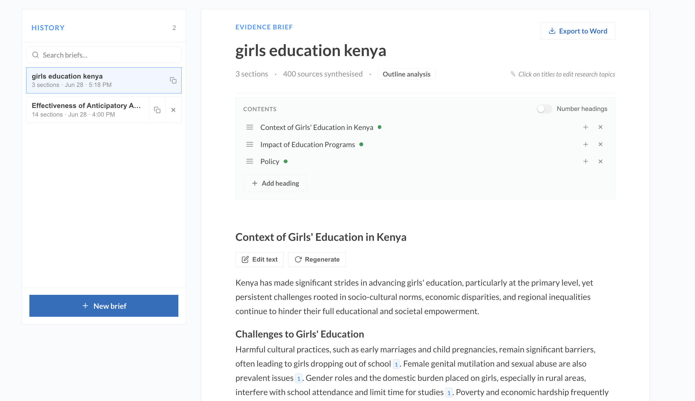
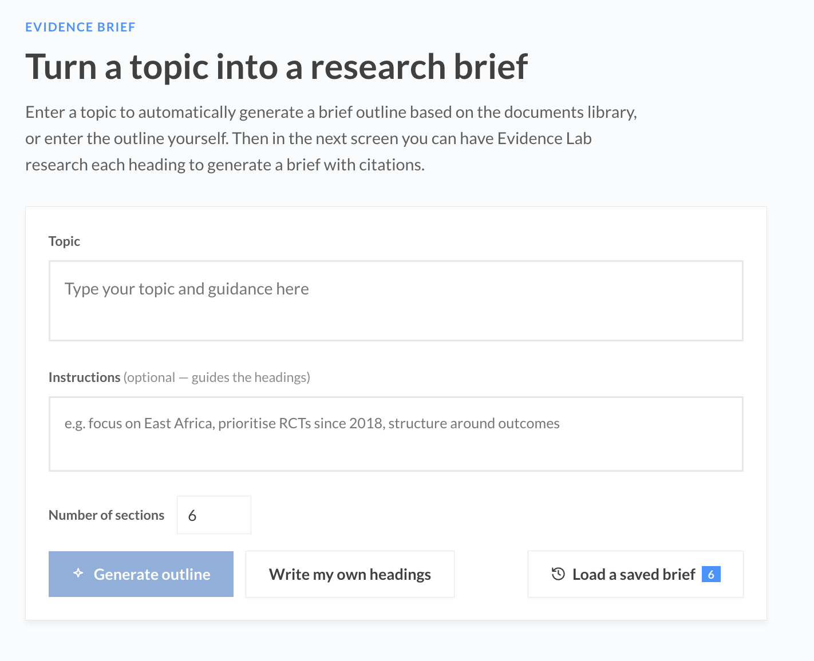
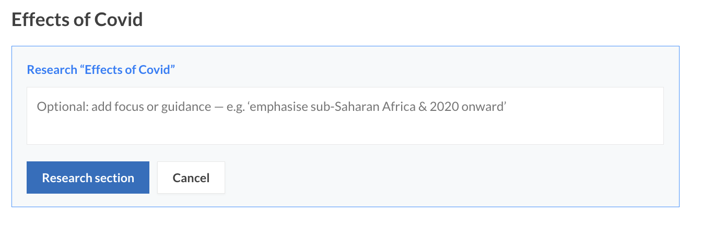
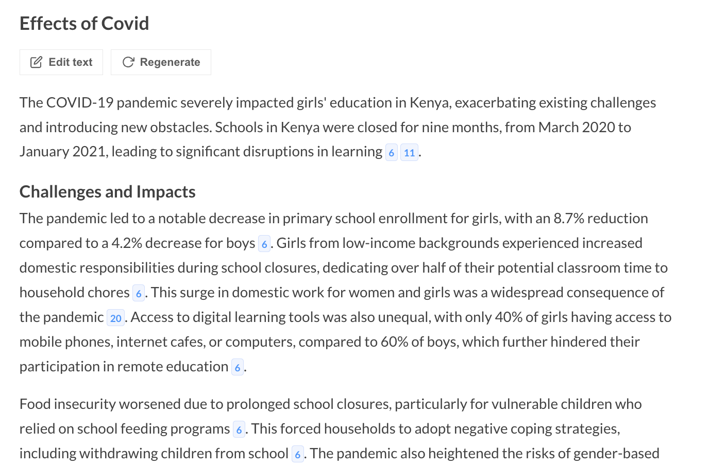
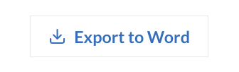
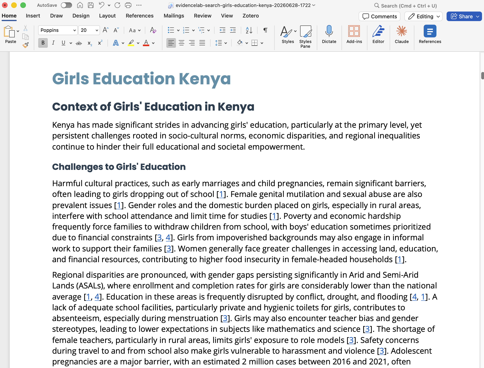

## Brief

**Brief** turns a topic into a structured, evidence-backed research brief. You give a topic (and optional guidance), Evidence Lab drafts an outline grounded in the document library, and you research each heading into cited prose that you can edit, reorder, and export to Word.

When you are signed in, briefs are saved to your account and open from **Brief Central** — the landing page listing your **Saved Briefs**, briefs **Shared with me**, your **Templates**, and your **Voice & tone** profiles.

The workspace itself has three parts:

- **Contents** (left) — where you add, name, reorder, and remove headings, and jump to a section. It follows you as you scroll and highlights the section you are reading.
- **The document** (middle) — the brief itself: each heading and its researched, cited text.
- **Comments** (right) — review threads on the brief, when there are any.

> Brief is a tab in the top navigation. If you don't see it, an administrator can enable it with `application.brief.enabled` in `config.json`.

---

### 1. Start a brief

**Signed in**, click **New brief** in Brief Central. The dialog has two tabs:

- **Generate using AI** — give a **Title**, optional **Instructions** (they steer the headings and, as the brief prompt, every section's research; the box grows as you type so long instructions stay readable), a **Voice & tone profile**, the number of **Sections** and the **Section length**, then click **Generate outline**.
- **Manual** — give a **Title** and pick a **Template**, or none for a blank outline. A template fills in its **Brief prompt**, **Voice & tone profile** and **Section length**, which you can change before clicking **Create brief** (see [Templates](#7-templates)).

**Signed out**, the Brief tab opens on the start screen instead.

You have three ways to start:

- **Generate outline** — enter a **Topic** (e.g. *girls education in Kenya*), optionally add **Instructions** to steer the headings (e.g. *focus on East Africa, prioritise RCTs since 2018, structure around outcomes*), choose the **Number of sections** and the **Section length** (see [Section length](#section-length) below), and click **Generate outline**. Evidence Lab runs a deep-research survey across the document library and proposes headings grounded in what the collection actually contains.
- **Write my own headings** — skip the survey and start from a small set of placeholder headings you edit yourself.
- **Load a saved brief** — reopen any brief from your history.

When an outline is generated, the brief name and headings are capitalised automatically (e.g. *girls education kenya* → *Girls Education Kenya*).

To see what the survey searched for, click **Outline analysis** under the title — it lists the queries run and the sources read. Use the **×** to close it.

---

### 2. Build and edit the outline (Contents)

Everything structural happens in the **Contents** panel at the top of the document.

- **Add a heading** — click **Add heading**, type a name, and press **Enter**. Nothing is added until you enter a name.
- **Add a sub-heading** — click the **+** on a heading, type a name, and press **Enter**.
- **Reorder** — drag the grip handle (the three-line icon) on a row to move a heading. A top-level heading carries its sub-headings with it; sub-headings reorder within their parent. Dragging works with both mouse and touch.
- **Remove** — click the **×** on a row to delete that heading.
- **Jump to a section** — click a heading's text to scroll straight to it in the document.
- **Number headings** — toggle the switch on the Contents row to show or hide hierarchical numbering (`1.`, `2.1`, …). It's off by default.

### Editing heading text

To rename a heading, click its title in the document and type — the title is editable inline. (Editing a placeholder heading also enables it for research.)

---

### 3. Research a heading with AI

Each heading starts un-researched. To fill one in, open it and click **Research this section**. Its research panel holds that section's prompt (optional focus or guidance), its voice & tone profile and its length, all of which you can set before running it. A brief started from a template arrives with these already filled in.

Evidence Lab runs deep research scoped to that heading — its searches take into account the brief topic, the heading's parent section (for sub-headings), the brief prompt and the section's own guidance — then writes cited prose for the section. When a heading introduces subheadings, the research planner sees their titles in its initial search plan and its follow-up decisions. It looks for evidence that explains their shared subject. The brief prompt and each section's guidance are saved with the brief, so they still apply when you reopen it later. The research uses your Search settings, including **Wide Search**: with it on, each search spreads across documents (best excerpt of each first) instead of drawing many excerpts from one report. You can research sections one at a time, or click **Start deep research** to research the whole outline in sequence. **■ Stop** halts a run in progress.

When a section finishes, it shows the written text with inline citations.

For each completed section you can:

- **Manually Edit** — change the prose by hand, then click **Done**.
- **Section History** — every change to the section: every generation, edit, update, manual edit and restore, with the question or instruction used. Click a row to see that version of the section compared with the version before it, and **Restore this version** to bring it back (see [Section history](#section-history) below).

Open **Ask AI** on a completed section to choose an AI action.

- **Regenerate** runs the research again from scratch. You can give new guidance or change the voice or length.
- **Edit** revises the section from its current text and citations. Give an instruction such as *make the viewpoint relate more to domestic policy*.
- **Get Updates** searches for sources published since the last run and adds new findings. You can give it a topic to focus on.

After any of these actions, the section shows its changes like tracked changes in Word: removed text struck through in red, new text in green. Three buttons sit above it:

- **Hide Changes** shows just the new text (and becomes **Show Changes**).
- **Keep Edits** accepts the change.
- **Reject Edits** puts back the text the section had before.

The change waits for you to keep or reject it, even if you reload the page or come back later; doing anything else to the section accepts it. When you come back to it, the section shows just the new text; to keep or reject it then, click its row, marked *awaiting review*, in the Section History. A rejected change stays in the section's Section History, marked *rejected*, so it can still be viewed or restored.

On wide screens the brief toolbar shows the whole-document AI actions as buttons. On small screens, open **Ask AI** to find them. **Regenerate All** runs the research for every section again, with the option to change the instructions, voice or length. **Get Updates for All Sections** updates every researched section. Review these changes in [Document History](#document-history).

Each researched section shows its word count next to its heading, and the line under the brief title shows the total.

#### Introductions to sub-headings

A top-level heading that has sub-headings is written as a short **introduction**: it frames the theme and says what each sub-heading goes on to examine, and leaves the findings to the sub-sections. It never adds headings of its own, and it does not cover in detail what its sub-headings will.

- **Length** — an introduction inherits the smaller of the brief’s target and the introduction default (normally 120 words). A target you set directly on the introduction takes precedence. Administrators can change the default length (`target_words`) and the number of automatic re-runs (`heading_retries`) in `config.json` under `application.brief.introductions`; if the setting is left out, 120 words and one re-run are used.
- **Order** — **Start deep research** and **Regenerate All** write each heading's sub-sections first and its introduction last, so the introduction can point to what the sub-sections actually say.
- **Headings** — if an introduction still comes back with headings of its own, it is researched again automatically (once by default). If it still has them after that, it is kept as written, with a warning on the section and a note in its **Section History**, so you can edit them out or choose **Regenerate** under **Ask AI**.
- **Edits** — **Edit** and **Get Updates** preserve the section's role as an introduction.

#### How a section is drafted and revised

One click on **Research this section** can involve several model requests. Brief searches the library, selects passages that match the assigned heading, and asks the writer for cited paragraphs. It uses document titles and catalogue fields to distinguish sources about different subjects. A first draft that meets the length and editorial checks can be used immediately.

| What the writer needs to fix | What happens during generation |
| --- | --- |
| A sentence has a missing or incorrect citation | Brief looks for a retrieved passage that supports the whole sentence. The writer can revise the wording to match the evidence. Unsupported findings are left out. |
| The draft is short | The writer measures the prose left after review and looks for supporting details. If the reviewed section is still short, it can add a paragraph. It looks first at retrieved passages the section has yet to cite and can revisit a cited passage for a new detail. Brief keeps the existing paragraphs and checks the addition for repetition and flow. A section can finish short when the evidence runs out. |
| The draft is long | The writer receives the measured word count and target so it can condense the explanation. If further trimming is needed, Brief keeps sentences in their original order and stops at a sentence boundary. |
| The prose is unclear or repeats another section | Brief checks the section in context. The writer can repair a dangling reference or unclear opening. To remove a repeated finding, the reviewer must identify earlier wording that already conveys it. |

These revisions are automatic and limited. The writing review also runs when the group’s optional citation checker is off. By default, sections describe findings directly. To discuss what a study did not measure, ask for evidence limitations in the heading or writing instructions. The writer must cite the source documenting the limitation.

#### Section length

Use **Section length** to set the word target. Use the prompt to explain what deserves the space. For example, a 350-word section might ask the writer to explain an observed change, compare two settings, and describe the conditions under which the change occurred.

| Where you set the length | Which sections use it |
| --- | --- |
| **Group Settings → Brief** | Supplies a starting length for new briefs. Administrators can also edit the group’s section writing prompt here. **Reset to Default** restores the shipped wording in the editor. |
| **Template or brief** | The template can supply the starting target. Change it when you create the brief or in **Ask AI → Regenerate All**. Sections set to **Use brief target** inherit it. Introductions have the shorter default described above. |
| **One section’s research panel** | A target set here takes precedence for that heading, including an introduction. |

The shipped choices are **Short** (150 words), **Standard** (350), **Long** (700), **Custom** (50–3,000), and **No target**. The model’s output allowance grows for longer targets so it has room to finish. The writer still measures the finished prose in words. In the Brief workspace, a section that exceeds its target by more than 25% by default triggers a separate **Condensing** edit, recorded in **Section History**. Administrators can configure the presets, range and workspace condensing tolerance under `application.brief.target_words` in `config.json`.

A section can finish short when additional text would go beyond the evidence. In a [Brief experiment](../admin/evaluation.md#compare-generated-brief-sections), the word-count check grades the finished section. A failing grade does not send it back to the writer.

#### Reading citations

Citations work like the rest of Evidence Lab: inline number badges link to the source document and page, an expandable **Evidence** panel lists the supporting documents for that section, and a compiled **References** list appears at the end of the brief. Citation numbers run consecutively across the whole brief in reading order (the first citation in the brief is `[1]`). By default there is one number per cited passage — the same numbering the Research Assistant uses, so a document cited from three pages carries three numbers. Two **Group by document** checkboxes above the References list change how the list is laid out, and the single-per-document option also changes the numbering itself (see [Export to Word](#5-export-to-word) below). The grouping you choose is saved with the brief.

The numbering is computed and stored by the server when a section is researched, edited, moved or removed, so the saved brief, the Word export, the Activity log and the [citation check](../admin/evaluation.md#brief-citation-check) all carry exactly the numbers you see on screen. Occasionally the research agent cites a number it never returned a source for; such a citation keeps the agent's own number and is shown in the section text as a red badge, in line with the text, instead of a normal citation; hover it to see that the agent cited a number it was never given. The section also shows a warning such as **2 citations have no source**, listing each number as a red chip: click a chip to jump to where that citation is used, and click it again to step through its other uses. Section History explains it too, listing such numbers as `[?n]`, which is also how they are kept in the saved text, so a claim without a source is never hidden.

#### Section history

Each section's **Section History** lists every change to the section, newest first. The row marked *current* is the version on screen. Click any row to see that version compared with the one before it; **Restore this version** brings it back as a new *Restored* row, so nothing in the history is lost and a restore can itself be undone. Generation rows recorded before version history was added (Evidence Lab v1.6.6) list the run but cannot be opened, because their text was not kept; older edit and update rows can.

Section History is stored with the brief on the server, so it is the same in every browser and for everyone the brief is shared with. People the brief is shared with can open it and view old versions but not restore them. Signed out, a brief lives only in your browser and has no Section History.

The **Original** link on a run opens the agent's output exactly as it was returned — its text with its own numbering and its source records — together with a table showing what each of the agent's numbers became on screen and which source it points at, so any citation can be traced back to where it came from.

#### Document History

**Document History**, beside the brief title, lists every version of the whole brief: each research run, edit, rejected change, restore, and change to the headings or settings, with who made it and when. Saves made while typing (renaming headings, editing text by hand, changing settings) by the same person within five minutes are merged into one version, so the list is not flooded with keystrokes.

Click a version to see the whole brief as it was then, compared with the version before it: changed text is struck out in red or added in green, new sections are marked *added* and removed sections *removed*. **Restore this version** (owner only) puts back that version's headings, settings and section text. The restore is itself a new version, each restored section gets a *Restored* row in its own Section History, and comments are kept as they are.

Versions are written by the server with every change, so they never depend on the browser. Administrators can change the merging window with `application.brief.versions.merge_minutes` in `config.json` (5 if left out; 0 records every save as its own version).

---

### 4. Saved briefs (Brief Central)

Choose **Brief Central** above the contents to return to your briefs. Briefs save automatically as you research. Signed in, they are stored against your account (so they follow you between browsers) and listed under **Saved Briefs** in Brief Central. Each card shows the topic, section and source counts, the voice profile in use, and who it is shared with.

Each card has **Open Brief** and, for your own briefs, **Share** and **Delete**. Cards for briefs shared with you have **Copy** instead, which puts a private copy, titled "… (copy)", in your own **Saved Briefs** for you to edit. **New brief** opens the New brief dialog (see [Start a brief](#1-start-a-brief)). The other tabs list briefs **Shared with me**, your **Templates** and your **Voice & tone** profiles, including those others have shared with you.

> Signed out, briefs are kept in your browser's local storage instead, and sharing, templates, voice profiles, comments, Section History and Document History are unavailable.

#### All Briefs (administrators)

Administrators see one more tab in Brief Central, **All Briefs (Admin)**, listing every brief in the system with its owner's name and email. The search box at the top filters the cards by brief name or by user.

- **Open Brief** opens any brief. Someone else's brief opens read-only, labelled with its owner; you cannot change, re-research, share or delete it.
- **Copy** puts a copy in your own **Saved Briefs**, titled "… (copy)". The copy is private and yours to edit; the original's shares and comments stay with the original.

Opening or copying a brief you neither own nor were sent is recorded in the audit log (see [User Administration](../admin/user-administration.md)).

---

### 5. Export to Word

When your brief is ready, click **Export to Word** at the top right.

The exported document mirrors what you see on screen: inline `[n]` citation numbers in the prose and a compiled **References** list at the end, laid out according to the **Group by document** checkboxes above that list (tick at most one). Each reference adds the document's publication year after its title; a document with no recorded year shows its title alone.

- **Neither ticked** — one line per citation, with its page: `[1] Title, 2021, p.32`.
- **Group by document (multiple per document)** — one line per document listing each of its citation numbers with the page it points at: `Title, 2021, [1] p. 32, [2] p. 56`. The numbering is unchanged, so this is more compact when a brief leans on a handful of reports.
- **Group by document (single per document)** — one number per document and no page numbers: `[1] Title, 2021`. Every passage cited from the same document shares that number, so the prose is renumbered too — `A fact happened. [1][3]` becomes `A fact happened. [1]` when both citations came from the same report. Clicking an inline number still opens the document at the passage it was cited from.

**Where the links point.** Under the checkboxes, **Word links to** chooses where the exported document's links open:

- **Source document** (the default) — each document's own address outside Evidence Lab, its PDF or report page, opened at the cited page (`#page=N`). A document with no address of its own links to its copy in Evidence Lab instead.
- **Evidence Lab** — the copy of each document in Evidence Lab, opened at the cited page. Use it when readers should stay in Evidence Lab, or when source sites move or need a sign-in.

Links in the References list that stand for a whole document open it at its first page.

The exported `.docx` is a polished, branded document titled **AI-generated Research Brief**, with:

- A clickable **table of contents** that jumps to each heading (no "update fields" prompt on open).
- An information box noting the content is AI-generated and should be verified.
- The brief topic as the heading, followed by each section's text.
- Citations linked to the **actual source PDF at the cited page**, so a reader outside Evidence Lab can open the document in their browser. The **Reference Excerpts** section carries the supporting passages. Any tables or figures in those passages are embedded as the same images shown on screen, so they keep their original layout.

> Brief content is generated by AI through deep research over the document library. Always verify factual claims and review for coverage and accuracy — it's a guide for the writing process, not a finished product.

---

### 6. Share a brief

Open a brief and click **Share**, or use **Share** on its card in Brief Central.

Sharing is **viewer-only**: recipients can read the brief, follow its citations, export it, leave comments and look through its Section History and Document History, but they cannot change the text, re-research a section, restore a version, or re-share it. Only the owner can edit.

- **Add people or groups** — start typing a name, email address or group name. Matching users and groups appear after two characters; click one (or pick it with the arrow keys and press **Enter**) to share with it straight away. You can also type a full email address or group name and click **Add**. Groups share with every current member.
- **Brief link** — copy the brief's URL (`/brief/<id>`) and send it. The link only opens for people you have added, so it is safe to paste into a channel where others might see it.
- **Remove access** — click the **×** beside a person or group.

Briefs shared with you appear under **Shared with me** in Brief Central, labelled with the owner's name. They open read-only; **Copy** makes your own editable copy, leaving the original and its comments with its owner.

---

### 7. Templates

A Brief template is a reusable outline. It can carry the research prompt, voice & tone profile, and word target for the whole brief. Each heading or subheading can add research instructions and override the inherited voice or length.

| To do this | Steps |
| --- | --- |
| Create a template from scratch | Open **Brief Central → Templates → New template**. Name it, add headings and subheadings, and use **Prompt** beside a heading to set its instructions, voice or length. Select **Save template**. |
| Reuse an existing brief | Open it and select **Save as Template**. **Include prompts and settings** is on by default. Turn on **Include section text** if new briefs should start with the existing prose too. Review the headings and save. |
| Start a brief | Select **Use Template** on its card, or select the template under **New brief → Manual**. Give the brief a title and adjust its settings. You can change an individual heading’s prompt, voice and length later in its research panel. |
| Change a template | Select **Edit** on a template you own. Subsequent briefs inherit the changes. Briefs you already created retain their own settings. To adapt someone else’s shared template, use **Copy** to make your own version. |

For example, a template might set a 350-word target and a plain-language voice for the whole brief. Its **Findings** heading can ask for a comparison of measured outcomes, while **Recommendations** can use a 150-word target and a voice profile written for decision-makers.

Administrators can also select templates in a [Brief experiment](../admin/evaluation.md#compare-generated-brief-sections). The experiment uses the **template name as the research topic**, so give it a name that identifies the subject you want to test. Each selected heading and subheading produces its own result. Editing the original template changes future runs.

---

### 8. Voice & tone profiles

A voice & tone profile is a set of style instructions applied whenever a section is written, so briefs read consistently for their audience — a donor board memo and a field-team summary need different registers.

- **Create one** — on the **Voice & tone** tab in Brief Central, click **New voice & tone profile** and give it a name, a one-line description of when to use it, and the style instructions themselves (for example: *Write in plain English at CEFR B2. Lead each section with the finding, then the evidence. Avoid acronyms on first use.*).
- **Apply it to a brief** — choose a profile in the New brief dialog (either tab), or in **Regenerate All**. A template can also set one.
- **Override it for one section** — a section's Research or Regenerate panel has its own profile selector; leave it on *Use brief default* to inherit the brief's.

The model reads these instructions when it writes the outline, researches a section, or revises a section with **Edit** under **Ask AI**.

---

### 9. Share templates and voice & tone profiles

Templates and voice & tone profiles can be shared, so a team writes to the same structure and in the same register. A typical use: a team lead builds a template with a prompt for each heading and the team's voice & tone profile, and shares it with the team's group, so every brief the team starts from it is researched and written the same way.

- **Share** — click **Share** on a template or profile you own, then add people by name or email address, or a whole group by name, exactly as for a brief: pick a suggestion to share with it straight away.
- **What recipients can do** — shared templates and profiles appear in their Brief Central, labelled with the owner's name, and in every template and voice picker. In Brief Central, recipients can use them and the owner can edit, delete or share them. Evaluation administrators can also edit an original template from a Brief evaluation dataset. People using the template see those edits. See [Brief evaluation templates](../admin/evaluation.md#compare-generated-brief-sections).
- **Make a copy** — click **Copy** on any template or profile to make your own private copy, which you can edit and share. Copying is how you adapt a shared template without changing the original.
- **Stop sharing** — open **Share** and remove the person or group. It disappears from their lists.

**Voices go with the template.** Sharing a template also shares the voice & tone profiles it uses that you own, with the same people and groups, so they receive it whole. A voice you add to the template later is shared with them too. Two limits:

- A voice someone else shared with you cannot be passed on. Recipients see **Unavailable voice & tone profile** there until its owner shares it with them.
- Stopping a template share leaves its voices shared, because you may have shared them for their own sake. Stop sharing a voice from its own **Share** dialog.

A section whose voice is unavailable, because it was unshared or deleted, is written without a voice, and its Research panel says so until you pick another profile.

**Where recipients find things.** Briefs shared with you are under **Shared with me** in Brief Central. Shared templates and voice & tone profiles are in your **Templates** and **Voice & tone** tabs, marked *Shared by* and the owner's name, and in every template and voice picker.

---

### 10. Comments

Comments let reviewers respond to a brief in place, which is the usual next step after sharing one.

- **Start a thread** — select any text in the brief and choose **Comment** from the toolbar that appears over the selection. The comment is anchored to the passage you highlighted, which is quoted at the top of the thread.
- **Reply** — type in the box at the bottom of a thread. Threads are one level deep, so a conversation stays readable.
- **Edit** — you can change the wording of your own comments at any time.
- **Resolve** — mark a thread as dealt with; the brief's owner can resolve any thread, and you can always resolve your own. Resolved threads are hidden until you tick **Show resolved**, and can be reopened.
- **Delete** — remove your own comment; the brief's owner can also clear a thread. Deleting the comment that opened a thread removes its replies too.

Anyone who can see a brief can comment on it, including viewers of a shared brief — that is the point of sharing one for review.

Because a comment is anchored to the **text** you highlighted rather than to a position in the document, it survives ordinary editing and re-flowing. If a section is re-researched and the quoted passage is gone entirely, the comment remains in the rail with its quote, so the discussion is not lost.

---

### 11. Fact Checker

Open **Fact Checker** in the brief toolbar. Choose **Run Fact Checker** to check the saved version using the selected model combination and your group’s judge settings. You can start a check once the brief has a written section and you have edit access. During the check, writing and editing controls are disabled for this brief. You can open another page and return to see progress. If this version already has results, **Run Fact Checker** is greyed out until the brief changes.

The floating bar shows which section is being checked and how many have finished. **Stop** ends the run. A section already being graded may finish its model calls. You can start it again from the menu. Refreshing the page reconnects to a running check.

When the check finishes, its results appear in the text. Choose **Hide results** beside the colour legend to return to reading. Use **Fact Checker → Show Fact Checks** to show them again. Readers with shared access can display completed results. When a section changes, its old highlights disappear. **Show Fact Checks** is greyed out if there are no results that still apply.

Click a claim badge or its highlighted sentence to open the assessment. The dialog shows the sentence, verdict, score and judge’s explanation. Under **Sources**, expand a reference to read the cited excerpt with the supporting words highlighted. Choose **See more** for a long excerpt or **Open source** to view it in the document. Click outside the dialog or press Escape to return to the brief. Older checks show the details recorded at the time.
