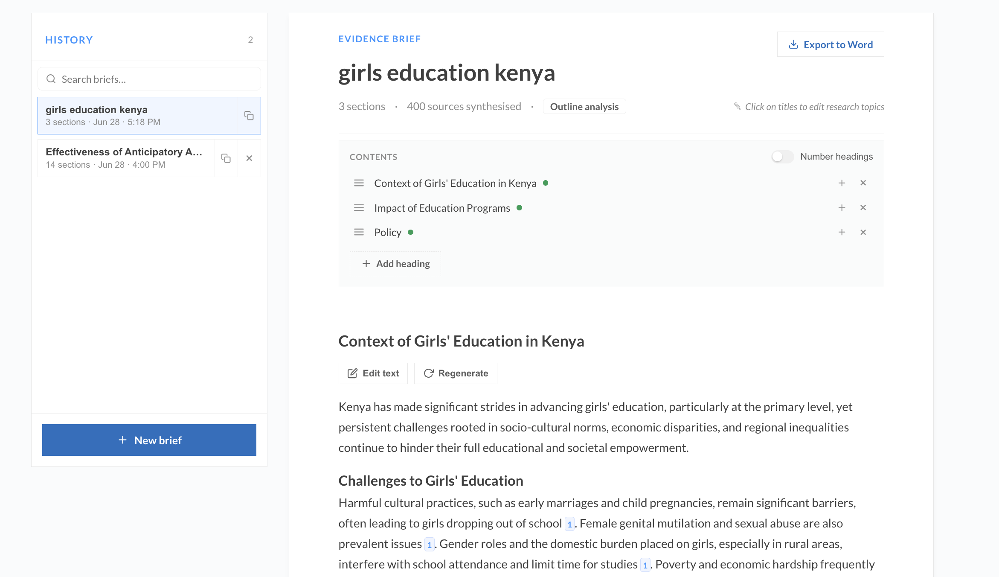
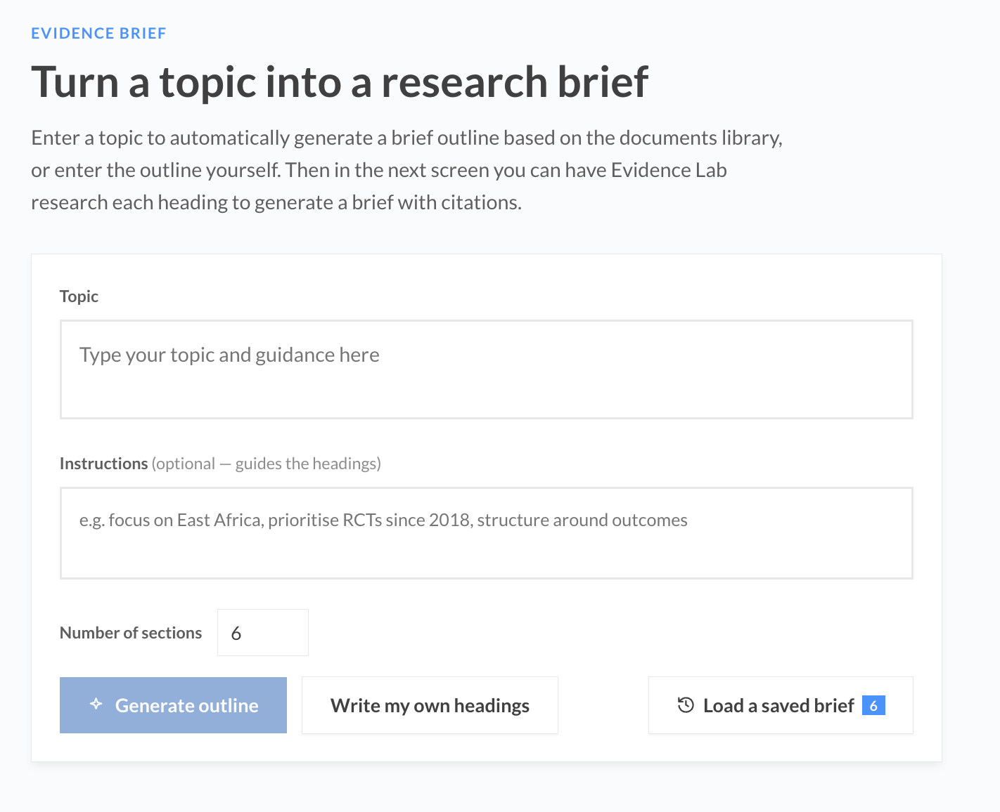
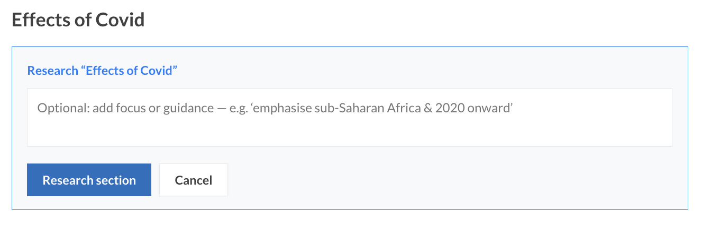
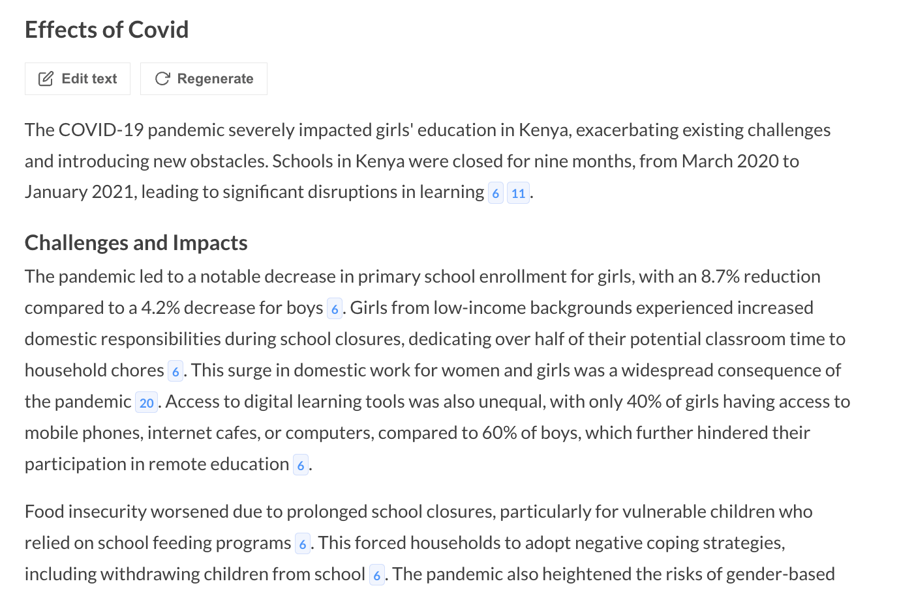
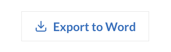
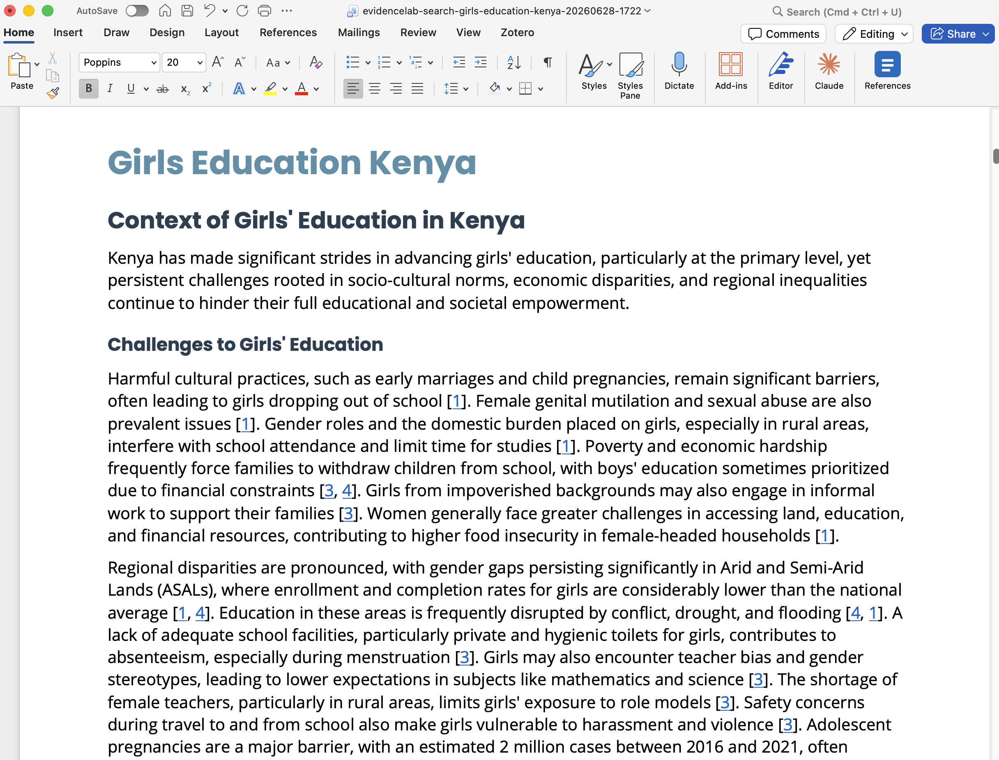

## Brief

**Brief** turns a topic into a structured, evidence-backed research brief. You give a topic (and optional guidance), Evidence Lab drafts an outline grounded in the document library, and you research each heading into cited prose that you can edit, reorder, and export to Word.

When you are signed in, briefs are saved to your account and open from **Brief Central** — the landing page listing your **Saved Briefs**, briefs **Shared with me**, your **Templates**, and your **Voice & tone** profiles.

The workspace itself has three parts:

- **Contents** (left) — where you add, name, reorder, and remove headings, and jump to a section. It follows you as you scroll and highlights the section you are reading.
- **The document** (middle) — the brief itself: each heading and its researched, cited text.
- **Comments** (right) — review threads on the brief, when there are any.

> Brief is a tab in the top navigation. If you don't see it, an administrator can enable it with `application.brief.enabled` in `config.json`.

---

### 1. Start a brief

**Signed in**, click **New brief** in Brief Central. The dialog has two tabs:

- **Generate using AI** — give a **Title**, optional **Instructions** (they steer the headings and, as the brief prompt, every section's research; the box grows as you type so long instructions stay readable), a **Voice & tone profile**, the number of **Sections** and the **Section length**, then click **Generate outline**.
- **Manual** — give a **Title** and pick a **Template**, or none for a blank outline. A template fills in its **Brief prompt**, **Voice & tone profile** and **Section length**, which you can change before clicking **Create brief** (see [Templates](#7-templates)).

**Signed out**, the Brief tab opens on the start screen instead.

You have three ways to start:

- **Generate outline** — enter a **Topic** (e.g. *girls education in Kenya*), optionally add **Instructions** to steer the headings (e.g. *focus on East Africa, prioritise RCTs since 2018, structure around outcomes*), choose the **Number of sections** and the **Section length** (see [Section length](#section-length) below), and click **Generate outline**. Evidence Lab runs a deep-research survey across the document library and proposes headings grounded in what the collection actually contains.
- **Write my own headings** — skip the survey and start from a small set of placeholder headings you edit yourself.
- **Load a saved brief** — reopen any brief from your history.

When an outline is generated, the brief name and headings are capitalised automatically (e.g. *girls education kenya* → *Girls Education Kenya*).

To see what the survey searched for, click **Outline analysis** under the title — it lists the queries run and the sources read. Use the **×** to close it.

---

### 2. Build and edit the outline (Contents)

Everything structural happens in the **Contents** panel at the top of the document.

- **Add a heading** — click **Add heading**, type a name, and press **Enter**. Nothing is added until you enter a name.
- **Add a sub-heading** — click the **+** on a heading, type a name, and press **Enter**.
- **Reorder** — drag the grip handle (the three-line icon) on a row to move a heading. A top-level heading carries its sub-headings with it; sub-headings reorder within their parent. Dragging works with both mouse and touch.
- **Remove** — click the **×** on a row to delete that heading.
- **Jump to a section** — click a heading's text to scroll straight to it in the document.
- **Number headings** — toggle the switch on the Contents row to show or hide hierarchical numbering (`1.`, `2.1`, …). It's off by default.

### Editing heading text

To rename a heading, click its title in the document and type — the title is editable inline. (Editing a placeholder heading also enables it for research.)

---

### 3. Research a heading with AI

Each heading starts un-researched. To fill one in, open it and click **Research this section**. Its research panel holds that section's prompt (optional focus or guidance), its voice & tone profile and its length, all of which you can set before running it. A brief started from a template arrives with these already filled in.

Evidence Lab runs deep research scoped to that heading — its searches take into account the brief topic, the heading's parent section (for sub-headings), the brief prompt and the section's own guidance — then writes cited prose for the section. The brief prompt and each section's guidance are saved with the brief, so they still apply when you reopen it later. The research uses your Search settings, including **Wide Search**: with it on, each search spreads across documents (best excerpt of each first) instead of drawing many excerpts from one report. You can research sections one at a time, or click **Start deep research** to research the whole outline in sequence. **■ Stop** halts a run in progress.

When a section finishes, it shows the written text with inline citations.

For each completed section you can:

- **Manually Edit** — change the prose by hand, then click **Done**.
- **AI Regenerate** — re-run the research from scratch, optionally with new guidance, a different voice or a different length.
- **AI Edit** — give an instruction (for example *make the viewpoint relate more to domestic policy*) and the section is revised to it, keeping its current text and citations rather than starting again.
- **AI Get Updates** — search the library for sources published since the section was last researched and fold any new findings in, with an optional focus.
- **Section History** — every change to the section: every generation, edit, update, manual edit and restore, with the question or instruction used. Click a row to see that version of the section compared with the version before it, and **Restore this section version** to bring it back (see [Section history](#section-history) below).

After an **AI Regenerate**, **AI Edit** or **AI Get Updates** on one section, the section shows its changes like tracked changes in Word: removed text struck through in red, new text in green. Three buttons sit above it:

- **Hide Changes** shows just the new text (and becomes **Show Changes**).
- **Keep Edits** accepts the change.
- **Reject Edits** puts back the text the section had before.

The change waits for you to keep or reject it, even if you reload the page or come back later; doing anything else to the section accepts it. When you come back to it, the section shows the new text with these buttons, and **Show Changes** brings the tracked changes back. A rejected change stays in the section's Section History, marked *rejected*, so it can still be viewed or restored. **AI Regenerate All** and **AI Get All Recent Updates** do not ask you to review each section; their changes appear in [Document History](#document-history) instead.

For the whole brief, **AI Regenerate All** re-researches every section with new instructions, voice or length, and **AI Get All Recent Updates** runs Get Updates on every researched section.

Each researched section shows its word count next to its heading, and the line under the brief title shows the total.

#### Introductions to sub-headings

A top-level heading that has sub-headings is written as a short **introduction**: it frames the theme and says what each sub-heading goes on to examine, and leaves the findings to the sub-sections. It never adds headings of its own, and it does not cover in detail what its sub-headings will.

- **Length** — an introduction is kept short: about 120 words unless you set a length on that section itself in its research panel. It is never longer than the brief's own section length. Administrators can change the default length (`target_words`) and the number of automatic re-runs (`heading_retries`) in `config.json` under `application.brief.introductions`; if the setting is left out, 120 words and one re-run are used.
- **Order** — **Start deep research** and **AI Regenerate All** write each heading's sub-sections first and its introduction last, so the introduction can point to what the sub-sections actually say.
- **Headings** — if an introduction still comes back with headings of its own, it is researched again automatically (once by default). If it still has them after that, it is kept as written, with a warning on the section and a note in its **Section History**, so you can edit them out or use **AI Regenerate**.
- **Edits** — **AI Edit** and **AI Get Updates** keep an introduction an introduction.

#### Section length

A brief can ask for sections of about a given number of words. Choose a **Section length** when you start a brief (Short, Standard, Long, a custom number, or *No target*, which lets the model decide, as before), change it for the whole brief in **AI Regenerate All**, or override it for one section in that section's research panel, where *Use brief target* inherits the brief's setting. The target is remembered with the brief. Your team may set a default in the group settings.

The target is enforced three ways, because a model on its own only approximates a word count:

1. The research prompt asks for about that many words, in place of its usual "at least three or four paragraphs".
2. The model's output limit is raised so a long target is never cut off mid-sentence.
3. When a section comes back more than a quarter longer than its target, Evidence Lab condenses it with an AI edit that keeps every citation. You will see *Condensing to about N words* in the section's activity while that runs, and the edit is recorded in the section's **Section History**.

Sections that come back short are left as they are: the target is a ceiling on length as much as a goal, and padding a section would only dilute its evidence. The presets, the allowed range and the tolerance are set in `config.json` under `application.brief.target_words`.

Citations work like the rest of Evidence Lab: inline number badges link to the source document and page, an expandable **Evidence** panel lists the supporting documents for that section, and a compiled **References** list appears at the end of the brief. Citation numbers run consecutively across the whole brief in reading order (the first citation in the brief is `[1]`). By default there is one number per cited passage — the same numbering the Research Assistant uses, so a document cited from three pages carries three numbers. Two **Group by document** checkboxes above the References list change how the list is laid out, and the single-per-document option also changes the numbering itself (see [Export to Word](#5-export-to-word) below). The grouping you choose is saved with the brief.

The numbering is computed and stored by the server when a section is researched, edited, moved or removed, so the saved brief, the Word export, the Activity log and the [citation check](../admin/evaluation.md#brief-citation-check) all carry exactly the numbers you see on screen. Occasionally the research agent cites a number it never returned a source for; such a citation is shown as `[?n]` (with the agent's own number), the section shows a warning, and Section History explains it, so a claim without a source is never hidden.

#### Section history

Each section's **Section History** lists every change to the section, newest first. The row marked *current* is the version on screen. Click any row to see that version compared with the one before it; **Restore this section version** brings it back as a new *Restored* row, so nothing in the history is lost and a restore can itself be undone. Generation rows recorded before version history was added (Evidence Lab v1.6.6) list the run but cannot be opened, because their text was not kept; older edit and update rows can.

Section History is stored with the brief on the server, so it is the same in every browser and for everyone the brief is shared with. People the brief is shared with can open it and view old versions but not restore them. Signed out, a brief lives only in your browser and has no Section History.

The **Original** link on a run opens the agent's output exactly as it was returned — its text with its own numbering and its source records — together with a table showing what each of the agent's numbers became on screen and which source it points at, so any citation can be traced back to where it came from.

#### Document History

**Document History**, beside the brief title, lists every version of the whole brief: each research run, edit, rejected change, restore, and change to the headings or settings, with who made it and when. Saves made while typing (renaming headings, editing text by hand, changing settings) by the same person within five minutes are merged into one version, so the list is not flooded with keystrokes.

Click a version to see the whole brief as it was then, compared with the version before it: changed text is struck out in red or added in green, new sections are marked *added* and removed sections *removed*. **Restore whole brief to this version** (owner only) puts back that version's headings, settings and section text. The restore is itself a new version, each restored section gets a *Restored* row in its own Section History, and comments are kept as they are.

Versions are written by the server with every change, so they never depend on the browser. Administrators can change the merging window with `application.brief.versions.merge_minutes` in `config.json` (5 if left out; 0 records every save as its own version).

---

### 4. Saved briefs (Brief Central)

Briefs save automatically as you research. Signed in, they are stored against your account (so they follow you between browsers) and listed under **Saved Briefs** in Brief Central. Each card shows the topic, section and source counts, the voice profile in use, and who it is shared with.

Each card has **Open Brief** and, for your own briefs, **Share** and **Delete**. Cards for briefs shared with you have **Copy** instead, which puts a private copy, titled "… (copy)", in your own **Saved Briefs** for you to edit. **New brief** opens the New brief dialog (see [Start a brief](#1-start-a-brief)). The other tabs list briefs **Shared with me**, your **Templates** and your **Voice & tone** profiles, including those others have shared with you.

> Signed out, briefs are kept in your browser's local storage instead, and sharing, templates, voice profiles, comments, Section History and Document History are unavailable.

#### All Briefs (administrators)

Administrators see one more tab in Brief Central, **All Briefs (Admin)**, listing every brief in the system with its owner's name and email. The search box at the top filters the cards by brief name or by user.

- **Open Brief** opens any brief. Someone else's brief opens read-only, labelled with its owner; you cannot change, re-research, share or delete it.
- **Copy** puts a copy in your own **Saved Briefs**, titled "… (copy)". The copy is private and yours to edit; the original's shares and comments stay with the original.

Opening or copying a brief you neither own nor were sent is recorded in the audit log (see [User Administration](../admin/user-administration.md)).

---

### 5. Export to Word

When your brief is ready, click **Export to Word** at the top right.

The exported document mirrors what you see on screen: inline `[n]` citation numbers in the prose and a compiled **References** list at the end, laid out according to the **Group by document** checkboxes above that list (tick at most one). Each reference adds the document's publication year after its title; a document with no recorded year shows its title alone.

- **Neither ticked** — one line per citation, with its page: `[1] Title, 2021, p.32`.
- **Group by document (multiple per document)** — one line per document listing each of its citation numbers with the page it points at: `Title, 2021, [1] p. 32, [2] p. 56`. The numbering is unchanged, so this is more compact when a brief leans on a handful of reports.
- **Group by document (single per document)** — one number per document and no page numbers: `[1] Title, 2021`. Every passage cited from the same document shares that number, so the prose is renumbered too — `A fact happened. [1][3]` becomes `A fact happened. [1]` when both citations came from the same report. Clicking an inline number still opens the document at the passage it was cited from.

**Where the links point.** Under the checkboxes, **Word links to** chooses where the exported document's links open:

- **Source document** (the default) — each document's own address outside Evidence Lab, its PDF or report page, opened at the cited page (`#page=N`). A document with no address of its own links to its copy in Evidence Lab instead.
- **Evidence Lab** — the copy of each document in Evidence Lab, opened at the cited page. Use it when readers should stay in Evidence Lab, or when source sites move or need a sign-in.

Links in the References list that stand for a whole document open it at its first page.

The exported `.docx` is a polished, branded document titled **AI-generated Research Brief**, with:

- A clickable **table of contents** that jumps to each heading (no "update fields" prompt on open).
- An information box noting the content is AI-generated and should be verified.
- The brief topic as the heading, followed by each section's text.
- Citations linked to the **actual source PDF at the cited page**, so a reader outside Evidence Lab can open the document in their browser. The **Reference Excerpts** section carries the supporting passages. Any tables or figures in those passages are embedded as the same images shown on screen, so they keep their original layout.

> Brief content is generated by AI through deep research over the document library. Always verify factual claims and review for coverage and accuracy — it's a guide for the writing process, not a finished product.

---

### 6. Share a brief

Open a brief and click **Share**, or use **Share** on its card in Brief Central.

Sharing is **viewer-only**: recipients can read the brief, follow its citations, export it, leave comments and look through its Section History and Document History, but they cannot change the text, re-research a section, restore a version, or re-share it. Only the owner can edit.

- **Add people or groups** — start typing a name, email address or group name. Matching users and groups appear after two characters; click one (or pick it with the arrow keys and press **Enter**) to share with it straight away. You can also type a full email address or group name and click **Add**. Groups share with every current member.
- **Brief link** — copy the brief's URL (`/brief/<id>`) and send it. The link only opens for people you have added, so it is safe to paste into a channel where others might see it.
- **Remove access** — click the **×** beside a person or group.

Briefs shared with you appear under **Shared with me** in Brief Central, labelled with the owner's name. They open read-only; **Copy** makes your own editable copy, leaving the original and its comments with its owner.

---

### 7. Templates

A template stores a heading structure, and the instructions for researching each heading, so the next brief starts with the shape and focus you want rather than a blank outline or an AI-generated one.

What a template keeps:

- **Headings and sub-headings**, and optionally the text written under each.
- **A prompt for each heading** — the research instructions for that section, the same thing you type in a section's Research panel (for example, *emphasise sub-Saharan Africa and evidence since 2020*).
- **A voice & tone profile and a length for each heading**, when a section should differ from the rest of the brief.
- **Settings for the whole brief** — a brief prompt applied to every section, a default voice & tone profile and a default section length.

Working with templates:

- **Save a brief as a template** — open a brief and click **Save as Template**. Each section's prompt, voice and length, and the brief's own prompt, voice and length, are carried into the template. Two switches decide what is kept: **Include section text** (off by default) and **Include prompts and settings** (on by default). You can edit everything before saving.
- **Create one from scratch** — on the **Templates** tab in Brief Central, click **New template** and add headings (and sub-headings) by hand. Click **Prompt** beside a heading to give it a prompt, a voice and a length.
- **Edit a template** — click **Edit** on a template you own. Changes apply to briefs started from it afterwards; briefs already started keep what they began with.
- **Use a template** — click **Use Template** on a template card, or pick it in the **Manual** tab of the New brief dialog. The dialog fills in the template's brief prompt, voice and length, which you can change before creating the brief. Each section starts with its heading's prompt, voice and length, so **Research this section** and **Start deep research** use them without retyping, and you can still change them in the section's research panel.

---

### 8. Voice & tone profiles

A voice & tone profile is a set of style instructions applied whenever a section is written, so briefs read consistently for their audience — a donor board memo and a field-team summary need different registers.

- **Create one** — on the **Voice & tone** tab in Brief Central, click **New voice & tone profile** and give it a name, a one-line description of when to use it, and the style instructions themselves (for example: *Write in plain English at CEFR B2. Lead each section with the finding, then the evidence. Avoid acronyms on first use.*).
- **Apply it to a brief** — choose a profile in the New brief dialog (either tab), or in **AI Regenerate All**. A template can also set one.
- **Override it for one section** — a section's Research or Regenerate panel has its own profile selector; leave it on *Use brief default* to inherit the brief's.

The instructions are passed to the model when the outline is generated, when a section is researched or regenerated, and when a section is revised with **AI Edit**.

---

### 9. Share templates and voice & tone profiles

Templates and voice & tone profiles can be shared, so a team writes to the same structure and in the same register. A typical use: a team lead builds a template with a prompt for each heading and the team's voice & tone profile, and shares it with the team's group, so every brief the team starts from it is researched and written the same way.

- **Share** — click **Share** on a template or profile you own, then add people by name or email address, or a whole group by name, exactly as for a brief: pick a suggestion to share with it straight away.
- **What recipients can do** — shared templates and profiles appear in their Brief Central, labelled with the owner's name, and in every template and voice picker. They can use them, but only the owner can edit, delete or share them. When the owner edits one, recipients get the change.
- **Make a copy** — click **Copy** on any template or profile to make your own private copy, which you can edit and share. Copying is how you adapt a shared template without changing the original.
- **Stop sharing** — open **Share** and remove the person or group. It disappears from their lists.

**Voices go with the template.** Sharing a template also shares the voice & tone profiles it uses that you own, with the same people and groups, so they receive it whole. A voice you add to the template later is shared with them too. Two limits:

- A voice someone else shared with you cannot be passed on. Recipients see **Unavailable voice & tone profile** there until its owner shares it with them.
- Stopping a template share leaves its voices shared, because you may have shared them for their own sake. Stop sharing a voice from its own **Share** dialog.

A section whose voice is unavailable, because it was unshared or deleted, is written without a voice, and its Research panel says so until you pick another profile.

**Where recipients find things.** Briefs shared with you are under **Shared with me** in Brief Central. Shared templates and voice & tone profiles are in your **Templates** and **Voice & tone** tabs, marked *Shared by* and the owner's name, and in every template and voice picker.

---

### 10. Comments

Comments let reviewers respond to a brief in place, which is the usual next step after sharing one.

- **Start a thread** — select any text in the brief and choose **Comment** from the toolbar that appears over the selection. The comment is anchored to the passage you highlighted, which is quoted at the top of the thread.
- **Reply** — type in the box at the bottom of a thread. Threads are one level deep, so a conversation stays readable.
- **Edit** — you can change the wording of your own comments at any time.
- **Resolve** — mark a thread as dealt with; the brief's owner can resolve any thread, and you can always resolve your own. Resolved threads are hidden until you tick **Show resolved**, and can be reopened.
- **Delete** — remove your own comment; the brief's owner can also clear a thread. Deleting the comment that opened a thread removes its replies too.

Anyone who can see a brief can comment on it, including viewers of a shared brief — that is the point of sharing one for review.

Because a comment is anchored to the **text** you highlighted rather than to a position in the document, it survives ordinary editing and re-flowing. If a section is re-researched and the quoted passage is gone entirely, the comment remains in the rail with its quote, so the discussion is not lost.
