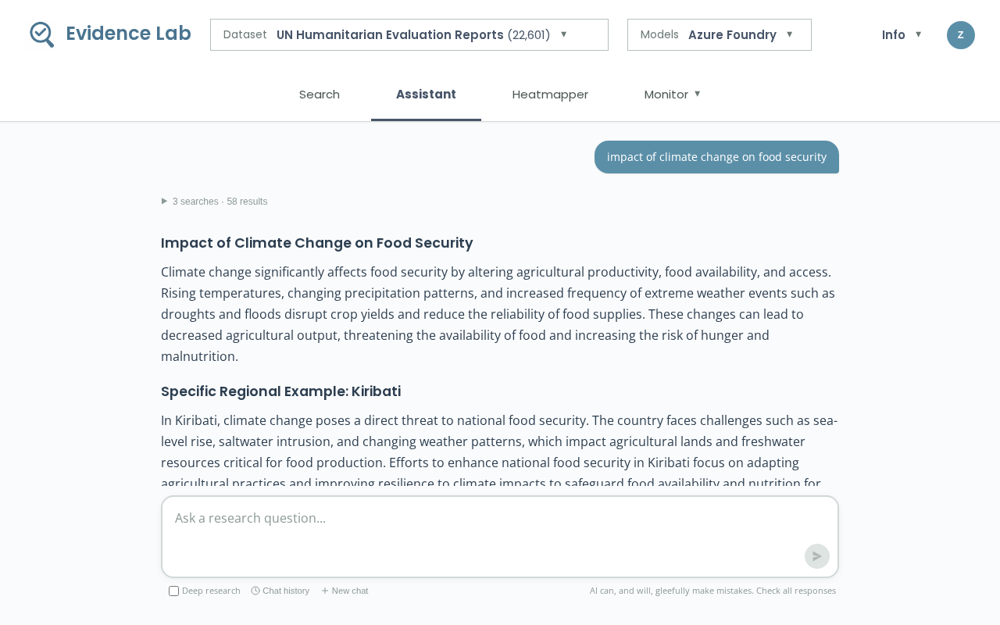

## Research Assistant

The Research Assistant is an AI-powered chat interface that answers questions about your document collection by searching, analyzing, and synthesizing evidence with full citations.

### Getting Started

1. Click the **Assistant** tab in the top navigation
2. Type a research question in the input box, or click one of the suggested example queries
3. The assistant will search your documents, then stream a structured response with inline citations

Each response includes:
- **Structured sections** with headings that organize the findings
- **Inline citation numbers** (e.g., 1 7 19) that reference specific document chunks
- **An expandable References section** listing all cited documents with titles and page numbers
- **A star rating** so you can provide feedback on response quality

### Normal Mode

The Assistant searches with your original question and checks whether the results answer it.
If a part of the question is unanswered, it can make focused follow-up searches, up to
four searches in total by default. It keeps useful passages from each search for the cited
answer. You can see the queries it ran and the number of results it found.

### Deep Research Mode

For questions that need more investigation, enable **Deep Research** with the checkbox
below the chat input.

Deep Research uses the same process with a budget of up to ten searches by default.
It looks for evidence from independent evaluations and checks disagreements, limitations
and differences across contexts. The Assistant can finish early when the evidence is sufficient.

### Multi-Turn Conversations

The assistant supports follow-up questions within the same conversation. Each message maintains the context of the previous exchange, allowing you to:

- Ask clarifying questions about a previous response
- Request the assistant to dig deeper into a specific finding
- Refine your research direction based on initial results

### Chat History

Authenticated users have access to chat history features:

- **Thread sidebar** — click the clock icon next to the input to open a sidebar showing past conversations
- **Thread persistence** — conversations are automatically saved as threads
- **Rename threads** — click the pencil icon on any thread to give it a descriptive name
- **Resume conversations** — click a thread to reload its messages and continue the conversation
- **New chat** — click "+ New chat" to start a fresh conversation

### Search Settings

The assistant respects the same search settings available in the Search tab. This includes:

- **Dense/sparse weights** — adjust the balance between semantic and keyword search
- **Reranking model** — choose which reranking model scores the results
- **Recency boost** — prioritize newer documents
- **Field boost** — boost results matching detected field values (e.g., country names)
- **Wide Search** — each of the assistant's searches spreads across documents (at most *Max results per document* from any one document). The assistant reads 20 results per search, so with Wide Search on it takes the best excerpt from each document first, giving it broader coverage of the library instead of many excerpts from one report.

These settings are configured via the Search Settings panel and automatically forwarded to the assistant's search tool.
